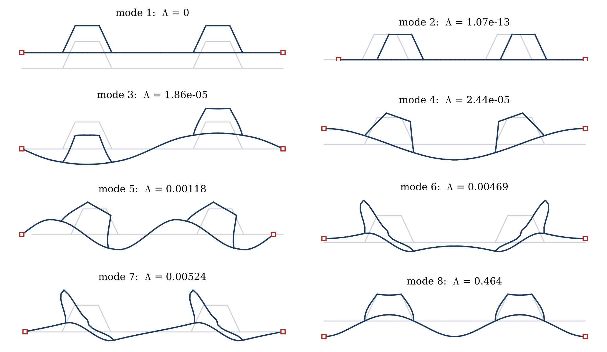

# Theory and formulation

The formulation follows the two stages of GBT {{schardt1994,silvestre2002a,bebiano2015}}: a cross-section analysis, which defines the deformation modes and the modal matrices of the periodic cell, and a member analysis, which determines the amplitude functions along $x$ by the Ritz method, as in the GBT–Ritz approach {{kharghani2025jcs,kharghani2026jcs}}. The notation of classical GBT is used throughout: $\bar u_k(s)$, $\bar v_k(s)$, $\bar w_k(s)$ are the displacement profiles of mode $k$ and $\varphi_k(x)$ its amplitude function.

## Wall constitutive law

Every wall is a laminated Reissner–Mindlin plate {{mindlin1951,whitney1970,reddy2004}}. With the generalised strains and stress resultants

$$
\begin{gathered}
\hat{\boldsymbol\varepsilon} = \left[\varepsilon_{xx},\ \varepsilon_{ss},\ \gamma_{xs},\ \kappa_{xx},\ \kappa_{ss},\ \kappa_{xs},\ \gamma_{xz},\ \gamma_{sz}\right]^{\mathsf T},\\
\hat{\boldsymbol\sigma} = \left[N_{xx},\ N_{ss},\ N_{xs},\ M_{xx},\ M_{ss},\ M_{xs},\ Q_{x},\ Q_{s}\right]^{\mathsf T}
\end{gathered} \eqn{gstrain}
$$

the constitutive law is $\hat{\boldsymbol\sigma} = \mathbf C\,\hat{\boldsymbol\varepsilon}$ with

$$
\begin{gathered}
\mathbf C = \begin{bmatrix} \mathbf A & \mathbf B & \mathbf 0\\ \mathbf B & \mathbf D & \mathbf 0\\ \mathbf 0 & \mathbf 0 & \mathbf A_s\end{bmatrix},\\
\left(A_{ij}, B_{ij}, D_{ij}\right) = \sum_{p=1}^{n_l}\int_{z_p}^{z_{p+1}} \bar Q^{(p)}_{ij}\left(1, z, z^2\right) dz,\\
\mathbf A_s = \tfrac56\sum_{p=1}^{n_l}\bar{\mathbf Q}^{(p)}_{s}\left(z_{p+1}-z_p\right)
\end{gathered} \eqn{abd}
$$

where $\bar{\mathbf Q}^{(p)}$ and $\bar{\mathbf Q}^{(p)}_s$ are the transformed reduced in-plane and transverse shear stiffness matrices of ply $p$, $i,j \in \{1,2,6\}$ and $n_l$ is the number of plies. All entries of $\mathbf A$, $\mathbf B$ and $\mathbf D$ are retained, including the membrane–bending coupling $\mathbf B$ of unsymmetric laminates and the anisotropic terms $A_{16}, A_{26}, D_{16}, D_{26}$. The transverse membrane resultant $N_{ss}$ is not condensed out, because the transverse-extension modes of Section 3.3 carry $\varepsilon_{ss}$ explicitly.

A stringer foot consists of the skin and the stringer flange, which are tied in the shell model. In GBT the two layers form one wall referred to the skin mid-plane. With $\mathbf A_0$, $\mathbf B_0$, $\mathbf D_0$ of the combined stack about its own mid-plane and $e$ the distance from the skin mid-plane to that of the stack, the parallel-axis transformation gives

$$
\mathbf A_e = \mathbf A_0,\qquad \mathbf B_e = \mathbf B_0 + e\,\mathbf A_0,\qquad \mathbf D_e = \mathbf D_0 + 2e\,\mathbf B_0 + e^2\mathbf A_0 . \eqn{foot}
$$

## Cross-section discretisation and stringer–skin tie

The mid-line of the cell is divided into walls (skin, feet, webs, crowns) and the walls into segments of length at most $b_s/25$, with at least two segments per wall. The end points of the walls are the *natural nodes* and the remaining segment end points are *intermediate nodes* (Figure 1b), as in classical GBT {{schardt1994,bebiano2015}}. For $b_s = 150$ mm the cell has 92 nodes, 19 walls and 93 segments. On a segment of length $l$ between nodes $a$ and $b$, with $\eta = (s-s_a)/l \in [0,1]$, the profiles $\bar u$ and $\bar v$ are linear, and $\bar w$ is the cubic Hermite interpolation of the nodal normal displacements and the nodal rotations $\theta = \bar w_{,s}$:

$$
\bar w(\eta) = H_1(\eta)\,\bar w_a + l\,H_2(\eta)\,\theta_a + H_3(\eta)\,\bar w_b + l\,H_4(\eta)\,\theta_b,\qquad
\begin{aligned} H_1 &= 1-3\eta^2+2\eta^3, & H_2 &= \eta-2\eta^2+\eta^3,\\ H_3 &= 3\eta^2-2\eta^3, & H_4 &= -\eta^2+\eta^3 .\end{aligned} \eqn{hermite}
$$

The nodal rotation is shared by all walls that meet at a node (rigid fold lines). The in-plane displacement of node $i$ is the vector $\mathbf U_i = (U_{X,i}, U_{Y,i})$; on a segment with unit tangent $\mathbf t$ and unit normal $\mathbf n$, $\bar v = \mathbf t\cdot\mathbf U$ and $\bar w = \mathbf n\cdot\mathbf U$ at its end nodes. The space spanned by Eq. (@hermite) is the same as that of the classical description by nodal transverse moments (Schardt's plate-strip flexibility formulation used in {{kharghani2025jcs}}); the nodal Hermite form is used because it makes the periodic constraints of Section 3.4 linear rows on nodal quantities. All cross-section integrals use four Gauss points per segment.

In the shell model the stringer mid-surface is tied to the skin with the offset $c$. In GBT, every web root is a node at $Y = c$, joined to the skin node below it by a *link wall* of height $c$. The link wall must transmit the in-plane displacements and the rotation like a line of rigid offset links, but it must not add axial or twisting stiffness. Its laminate is therefore built from the skin stiffnesses $\mathbf A_0$, $\mathbf D_0$, $\mathbf A_{s0}$ as

$$
\begin{aligned}
&A^{L}_{11} = 10^{-3}A_{0,11},\quad A^{L}_{22} = k_L A_{0,22},\quad A^{L}_{66} = k_L A_{0,66},\\
&D^{L}_{11} = 10^{-3}D_{0,11},\quad D^{L}_{22} = k_L D_{0,22},\quad D^{L}_{66} = 10^{-3}D_{0,66},\quad \mathbf A^{L}_s = k_L\mathbf A_{s0}
\end{aligned} \eqn{link}
$$

with $k_L = 10^3$ and all other entries zero; link walls carry no load. The result does not depend on $k_L$: for the isotropic SS panel with $b_s = 150$ mm and $\beta = 1.5$, $N_{cr} = 122.656$, $122.663$ and $122.660$ N/mm for $k_L = 10^2$, $10^3$ and $10^4$. A link wall with a stiff twisting term $D^{L}_{66}$ locks the root rotation and over-predicts $N_{cr}$ by 23 %; omitting it is the consistent choice for a row of rigid links.

## Kinematics and deformation mode families

### Displacement field

The displacement field of shear-deformable GBT {{silvestre2013shear,goncalves2014shear}} is extended here by the transverse shear rotations of the Reissner–Mindlin walls. The mid-surface displacements and the transverse shear rotations are

$$
\begin{aligned}
u(x,s) &= \sum_{k\in\mathcal C}\bar u_k(s)\,\varphi_{k,x}(x) + \varphi_a(x) + \sum_{j\in\mathcal S}\bar u_j(s)\,\varphi_j(x),\\
v(x,s) &= \sum_{k\in\mathcal C}\bar v_k(s)\,\varphi_k(x),\qquad
w(x,s) = \sum_{k\in\mathcal C}\bar w_k(s)\,\varphi_k(x),\\
\beta_x(x,s) &= \sum_{m\in\mathcal M_x}\bar c_m(s)\,\chi_m(x),\qquad
\beta_s(x,s) = \sum_{m\in\mathcal M_s}\bar b_m(s)\,\vartheta_m(x),
\end{aligned} \eqn{kin}
$$

where $\mathcal C$ is the set of conventional modes, whose warping $\bar u_k$ follows from their in-plane deformation, $\varphi_a$ the amplitude of the uniform axial mode, $\mathcal S$ the set of shear (warping) modes with independent amplitudes $\varphi_j$, and $\mathcal M_x$, $\mathcal M_s$ the sets of transverse shear (Mindlin) modes. The rotations of the wall normal are $\phi_x = -w_{,x}+\beta_x$ and $\phi_s = -w_{,s}+\beta_s$, so that the in-plane displacements at a distance $z$ from the mid-surface are $u + z\phi_x$ and $v + z\phi_s$. For $\beta_x = \beta_s = 0$ the Kirchhoff kinematics of classical GBT is recovered.

### Strain–displacement relations

The linear strains of a flat wall are

$$
\begin{aligned}
\varepsilon_{xx} &= u_{,x}, & \varepsilon_{ss} &= v_{,s}, & \gamma_{xs} &= u_{,s}+v_{,x},\\
\kappa_{xx} &= \phi_{x,x} = -w_{,xx}+\beta_{x,x}, & \kappa_{ss} &= \phi_{s,s} = -w_{,ss}+\beta_{s,s}, & \kappa_{xs} &= \phi_{x,s}+\phi_{s,x} = -2w_{,xs}+\beta_{x,s}+\beta_{s,x},\\
\gamma_{xz} &= w_{,x}+\phi_x = \beta_x, & \gamma_{sz} &= w_{,s}+\phi_s = \beta_s .
\end{aligned} \eqn{strains}
$$

Collecting all amplitude functions in $\mathbf q(x) = \left[\boldsymbol\varphi_{\mathcal C};\ \varphi_a;\ \boldsymbol\varphi_{\mathcal S};\ \boldsymbol\chi;\ \boldsymbol\vartheta\right]$ ($n$ modes) and inserting Eq. (@kin) into Eq. (@strains) gives

$$
\hat{\boldsymbol\varepsilon}(x,s) = \sum_{d=0}^{2}\mathbf E^{(d)}(s)\,\mathbf q^{(d)}(x),\qquad \mathbf q^{(d)} = \frac{d^d\mathbf q}{dx^d}, \eqn{strainop}
$$

where the columns $\mathbf E^{(d)}_k(s)$ are the generalised strains produced by a unit $d$-th derivative of the amplitude of mode $k$. Their non-zero entries are listed in Table 2. The conventional rows contain the classical GBT strains; the entries $\varepsilon_{ss} = \bar v_{k,s}$ belong to the transverse-extension modes, and the entries of the shear and Mindlin modes are those of shear-deformable GBT.

::: {custom-style="MDPI_4.1_table_caption"}
**Table 2.** Non-zero generalised strains $\mathbf E^{(d)}_k$ of one mode for a unit $d$-th derivative of its amplitude.
:::

| Mode (amplitude) | $d = 0$ | $d = 1$ | $d = 2$ |
|:--|:--|:--|:--|
| conventional ($\varphi_k$) | $\varepsilon_{ss} = \bar v_{k,s}$, $\kappa_{ss} = -\bar w_{k,ss}$ | $\gamma_{xs} = \bar u_{k,s}+\bar v_k$, $\kappa_{xs} = -2\bar w_{k,s}$ | $\varepsilon_{xx} = \bar u_k$, $\kappa_{xx} = -\bar w_k$ |
| axial ($\varphi_a$) | – | $\varepsilon_{xx} = 1$ | – |
| shear ($\varphi_j$) | $\gamma_{xs} = \bar u_{j,s}$ | $\varepsilon_{xx} = \bar u_j$ | – |
| Mindlin, $\beta_x$ ($\chi_m$) | $\kappa_{xs} = \bar c_{m,s}$, $\gamma_{xz} = \bar c_m$ | $\kappa_{xx} = \bar c_m$ | – |
| Mindlin, $\beta_s$ ($\vartheta_m$) | $\kappa_{ss} = \bar b_{m,s}$, $\gamma_{sz} = \bar b_m$ | $\kappa_{xs} = \bar b_m$ | – |

### Deformation mode families

Let $N$ be the number of nodes. The in-plane nodal displacements $\mathbf U = [\mathbf U_1;\dots;\mathbf U_N] \in \mathbb R^{2N}$ and the nodal rotations $\boldsymbol\Theta \in \mathbb R^N$ describe the in-plane deformation of the cross-section. Let $\mathbf E_\ell$ be the matrix that gives the elongation of every segment, $(\mathbf E_\ell\mathbf U)_r = \mathbf t_r\cdot(\mathbf U_b-\mathbf U_a)$. Following the organisation of the mode families of {{bebiano2015,goncalves2014shear}}, the conventional modes are defined by

* **G (global):** the rigid in-plane translations and rotation of the cross-section, as far as the side conditions admit them;
* **D (distortional):** in-plane nodal displacement fields without segment elongation, $\mathbf E_\ell\mathbf U = \mathbf 0$ (Vlasov's null transverse membrane strain), orthogonal to G and L;
* **L (local):** a unit normal displacement of one node that is not a wall junction, and one pure nodal rotation per node (the in-plane fields of G, D and T carry no nodal rotations, so the rotations are independent coordinates);
* **T (transverse extension):** segment elongation patterns, the columns of $\mathbf E_\ell^{\mathsf T}$;

and the non-conventional modes by

* **A (axial):** the uniform axial displacement $u = \varphi_a$;
* **S (shear):** the nodal hat functions $h_i(s)$ of the warping $\bar u_j$ (one is dropped, since their sum is the axial mode);
* **M (Mindlin):** for $\beta_x$, a nodal vector $\boldsymbol\Omega_i$ in the cross-section plane, with $\bar c_m = \mathbf t\cdot\boldsymbol\Omega$ on every segment (one vector at a node inside a straight wall, two at a fold line); for $\beta_s$, one nodal scalar per node.

Since $\mathbb R^{2N} = \ker\mathbf E_\ell \oplus \operatorname{range}\mathbf E_\ell^{\mathsf T}$, the families G, D, L and T together span all in-plane nodal displacements, and the rotation columns make the nodal rotations independent. The conventional modes are therefore a complete nodal description of the in-plane deformation, organised in the GBT families; the mode counts are given in Table 3.

*Warping of the global and distortional modes.* In classical GBT, the warping $\bar u_k$ of the G and D modes follows from Vlasov's condition of null membrane shear strain {{vlasov1961,schardt1994}}, $\gamma_{xs} = \bar u_{k,s} + \bar v_k = 0$ on every wall. The omega stringer and the skin form closed cells, where this condition cannot be satisfied exactly. The warping is therefore determined as the stiffness-weighted least-squares solution

$$
\min_{\bar{\mathbf u}}\ \sum_r \hat A_{66,r}\,l_r\left(\frac{\bar u_{b(r)}-\bar u_{a(r)}}{l_r}+\bar v_{r}\big|_{\eta = 1/2}\right)^2
\quad\text{subject to}\quad \mathbf c_{ax}^{\mathsf T}\bar{\mathbf u} = 0, \eqn{vlasov}
$$

with the sum over all segments $r$ of length $l_r$ between the nodes $a(r)$ and $b(r)$, $\hat A_{66} = A_{66}-A_{26}^2/A_{22}$ the membrane shear stiffness after condensing $N_{ss} = 0$, and $c_{ax,i} = \sum_{r\ni i}\tfrac12\hat A_{11,r}\,l_r$ with $\hat A_{11} = A_{11}-A_{12}^2/A_{22}$, so that the stiffness-weighted mean warping vanishes (no axial content). For an open section Eq. (@vlasov) reproduces the classical warping exactly (zero residual); in the closed cells the residual membrane shear is carried by the shear modes S.

## Periodic boundary conditions in GBT

### The periodic condition

The cell is one period of an infinitely wide panel. The displacement field at the side edge $X = -W$ (node $s_L$) must therefore equal that at $X = 0$ (node $s_R$), for all components and at every $x$:

$$
\mathcal U_\alpha(X=-W,\,x) = \mathcal U_\alpha(X=0,\,x),\qquad \alpha = 1,\dots,6,\qquad 0\le x\le L, \eqn{pbc}
$$

where $\mathcal U_\alpha$ are the six degrees of freedom of a shell node (three translations, three rotations). This is the condition that the Abaqus model imposes with one constraint equation per pair of side nodes and degree of freedom {{mittelstedt2007,mittelstedt2009periodic,schilling2020rineng}}. On the skin side edges, whose normal is $Y$, the shell degrees of freedom correspond to the GBT quantities in Table 4. Since all of them are linear in the amplitude functions, Eq. (@pbc) holds for every $x$ and every set of amplitude functions if and only if *every mode* satisfies it. The conditions are therefore built into the modes, family by family.

::: {custom-style="MDPI_4.1_table_caption"}
**Table 3.** Number of deformation modes per family for the two side conditions (Cross-ply lay-up; the counts do not depend on the lay-up).
:::

| $b_s$ [mm] | side edges | G | D | L | T | A | S | M | total |
|:--|:--|--:|--:|--:|--:|--:|--:|--:|--:|
| 150 | symmetry | 2 | 10 | 166 | 94 | 1 | 91 | 205 | 569 |
| 150 | periodic | 2 | 13 | 166 | 92 | 1 | 90 | 205 | 569 |
| 285.5 | symmetry | 2 | 10 | 138 | 80 | 1 | 77 | 174 | 482 |
| 285.5 | periodic | 2 | 13 | 138 | 78 | 1 | 76 | 174 | 482 |

::: {custom-style="MDPI_4.1_table_caption"}
**Table 4.** Degrees of freedom of a skin side node and the corresponding GBT conditions (Eqs. (@rows)–(@mindlinmerge)).
:::

| Shell DOF | Meaning at a skin side node | Periodic condition in GBT |
|:--|:--|:--|
| $U_1$ | in-plane displacement $U_X$ | $U_{X,s_L} = U_{X,s_R}$ (row of $\mathbf R$) |
| $U_2$ | deflection $U_Y = w$ | $U_{Y,s_L} = U_{Y,s_R}$ (row of $\mathbf R$) |
| $U_3$ | axial displacement $u$ | warping of G/D modes $\bar u_{s_L} = \bar u_{s_R}$; shear hats of $s_L$, $s_R$ merged; axial mode uniform |
| $UR_1$ | rotation $-w_{,x}+\beta_x$ | $w_{,x}$ periodic because $U_Y$ is; $\boldsymbol\Omega_{s_L} = \boldsymbol\Omega_{s_R}$ |
| $UR_3$ | rotation $w_{,s}+\beta_s = \theta+\beta_s$ | $\theta_{s_L} = \theta_{s_R}$ (row of $\mathbf R$); $\bar b_{s_L} = \bar b_{s_R}$ |
| $UR_2$ | drilling rotation | not a degree of freedom of the plate theory |

### Conventional modes

For the conventional modes the conditions $U_{X,s_L} = U_{X,s_R}$, $U_{Y,s_L} = U_{Y,s_R}$ and $\theta_{s_L} = \theta_{s_R}$ are the rows of a constraint matrix acting on the stacked nodal vector:

$$
\mathbf R\begin{bmatrix}\mathbf U\\ \boldsymbol\Theta\end{bmatrix} = \mathbf 0,\qquad
\mathbf R = \begin{bmatrix}\mathbf e^{\mathsf T}_{X,s_L}-\mathbf e^{\mathsf T}_{X,s_R}\\ \mathbf e^{\mathsf T}_{Y,s_L}-\mathbf e^{\mathsf T}_{Y,s_R}\\ \mathbf e^{\mathsf T}_{\theta,s_L}-\mathbf e^{\mathsf T}_{\theta,s_R}\end{bmatrix}\in\mathbb R^{3\times 3N}, \eqn{rows}
$$

where $\mathbf e_{X,i}$, $\mathbf e_{Y,i}$ and $\mathbf e_{\theta,i}$ are the unit vectors that extract $U_{X,i}$, $U_{Y,i}$ and $\theta_i$. Let $\mathbf B_g \in \mathbb R^{3N\times n_g}$ hold the nodal fields $[\mathbf U;\boldsymbol\Theta]$ of family $g \in \{G, D, L, T\}$ of the unconstrained cell. The constraint is imposed family by family, so that the mechanical meaning of the families is kept:

1. the columns of $\mathbf B_g$ that satisfy $\mathbf R\mathbf b = \mathbf 0$ are kept unchanged;
2. the remaining columns are replaced by a basis of the null space of the family, $\mathbf B_g \leftarrow \mathbf B_g\mathbf Z_g$ with $\mathbf Z_g = \ker(\mathbf R\mathbf B_g)$;
3. the vectors of $\ker\left(\mathbf R\,[\mathbf B_G\ \mathbf B_D\ \mathbf B_L\ \mathbf B_T]\right)$ that are not yet spanned (combinations of several families) are added, to the family T if they elongate a segment ($\mathbf E_\ell\mathbf U \neq \mathbf 0$) and to the family D otherwise;
4. each column is scaled to a unit maximum nodal displacement or rotation.

The resulting modal matrix $\mathbf B = [\mathbf B_G\ \mathbf B_D\ \mathbf B_L\ \mathbf B_T]$ satisfies $\mathbf R\mathbf B = \mathbf 0$ and spans the whole periodic subspace $\ker\mathbf R$. Consequently, for arbitrary amplitude functions,

$$
\mathbf R\sum_{k\in\mathcal C}\begin{bmatrix}\mathbf U_k\\ \boldsymbol\Theta_k\end{bmatrix}\varphi^{(d)}_k(x) = \mathbf 0\qquad\text{for all } x \text{ and } d = 0,1,2, \eqn{rowsall}
$$

and the same holds for any subset of the modes. The rigid rotation of the cross-section about the $x$-axis moves the two side nodes in opposite directions ($U_{Y,s_L}-U_{Y,s_R} = W\omega$ for a rotation $\omega$) and drops out: a torsional rigid-body motion of one cell is not compatible with an infinitely wide panel. The two rigid translations remain (the two G modes in Table 3). Compared with the symmetry side edges, where the rows are $U_{X} = \theta = 0$ at both side nodes, the periodic cell has more distortional modes (13 instead of 10 in Table 3): the side nodes may move laterally and rotate, provided that they do so identically.

### Warping of the global and distortional modes

For the warping of the G and D modes, the periodic condition $\bar u_{s_L} = \bar u_{s_R}$ is added to the constraint of Eq. (@vlasov). With the segment difference matrix $\mathbf H$, $(\mathbf H\bar{\mathbf u})_r = \bar u_{b(r)}-\bar u_{a(r)}$, the weight matrix $\mathbf W = \operatorname{diag}(\hat A_{66,r}/l_r)$, the vector $\mathbf g$ of the segment mid-point values $l_r\bar v_r(1/2)$, and the constraint matrix $\mathbf C_u = \left[\mathbf c_{ax}^{\mathsf T};\ \mathbf e^{\mathsf T}_{s_L}-\mathbf e^{\mathsf T}_{s_R}\right]$, the warping of each mode follows from one Karush–Kuhn–Tucker system:

$$
\begin{bmatrix}\mathbf H^{\mathsf T}\mathbf W\mathbf H & \mathbf C_u^{\mathsf T}\\ \mathbf C_u & \mathbf 0\end{bmatrix}
\begin{bmatrix}\bar{\mathbf u}\\ \boldsymbol\mu\end{bmatrix} =
\begin{bmatrix}-\mathbf H^{\mathsf T}\mathbf W\mathbf g\\ \mathbf 0\end{bmatrix}. \eqn{kkt}
$$

### Shear, Mindlin and axial modes

The shear modes are the nodal hat functions $h_i(s)$ of the warping. For periodic side edges the hat functions of the two side nodes are merged into one mode with a common warping value,

$$
h_{s_R} \leftarrow h_{s_R}+h_{s_L},\qquad h_{s_L}\ \text{removed}. \eqn{shearmerge}
$$

The Mindlin modes are nodal as well; the nodal functions of $s_L$ are added to those of $s_R$ and removed:

$$
\boldsymbol\Omega_{s_R}\leftarrow\boldsymbol\Omega_{s_R}+\boldsymbol\Omega_{s_L},\qquad \bar b_{s_R}\leftarrow\bar b_{s_R}+\bar b_{s_L},\qquad \boldsymbol\Omega_{s_L},\ \bar b_{s_L}\ \text{removed}. \eqn{mindlinmerge}
$$

The axial mode is uniform and periodic by construction. With symmetry side edges instead, the shear and Mindlin modes of the side nodes are kept separately and the $\beta_s$ modes of the side nodes are removed ($UR_3 = 0$).

### Remarks

*Exactness.* Equations (@rows)–(@mindlinmerge) make every mode satisfy Eq. (@pbc). Any linear combination with arbitrary amplitude functions, and in particular any truncated subset of the modes, therefore satisfies the periodic condition exactly. No penalty terms or Lagrange multipliers appear in the member analysis. For the cross-ply cell with $b_s = 150$ mm the largest difference between the two side nodes over all conventional modes is $7.9\times10^{-15}$ for the in-plane displacements, $1.1\times10^{-16}$ for the rotation and $2.3\times10^{-11}$ for the warping (unit-normalised modes), i.e. zero to round-off.

*Why the condition cannot be added to classical modes afterwards.* Classical GBT generates the conventional modes from a few natural nodes of an open contour. The periodic condition couples the two ends of the contour, so that the cell behaves like a closed loop with respect to its in-plane kinematics: the rigid rotation is no longer admissible, the warping must take the same value on both sides of the cut, and the classical hierarchy has to be recomputed. Imposed afterwards on a truncated set of classical modes, the three conditions of Eq. (@rows) remove three degrees of freedom from a small space and leave too few admissible modes. Here the modes are generated from a complete nodal basis and the constraint is applied before any truncation.

*Relation to Bloch–Floquet theory.* For an infinite panel with stringer pitch $b_s$, the buckling modes are Bloch waves, $\mathbf u(X+b_s, x) = e^{\mathrm i\kappa b_s}\mathbf u(X,x)$ {{mead1996}}. A periodic cell of width $2b_s$ admits exactly the two real cases $\kappa b_s = 0$ (the mode repeats in every bay) and $\kappa b_s = \pi$ (the mode alternates in sign from bay to bay). These are the two patterns that a two-bay cell can represent, and the same restriction applies to the Abaqus model with periodic side edges used for validation.

*Hierarchical modes.* For visualisation and for reduced bases, the conventional modes can be ordered as in classical GBT by the generalised eigenvalue problem $\bar{\mathbf B}\,\boldsymbol\psi = \Lambda\left(k_r^2\bar{\mathbf D}_1 + k_r^4\bar{\mathbf C}\right)\boldsymbol\psi$ at a reference wavenumber $k_r$, with the modal matrices of Section 3.5. Small $\Lambda$ means a preference for long waves (global, then distortional, then local). The first eight hierarchical modes of the periodic cell are shown in Figure 2. The two side nodes move identically in every mode, including the lateral rigid translation (mode 2), while the rigid rotation is absent.

{width=15.5cm}
