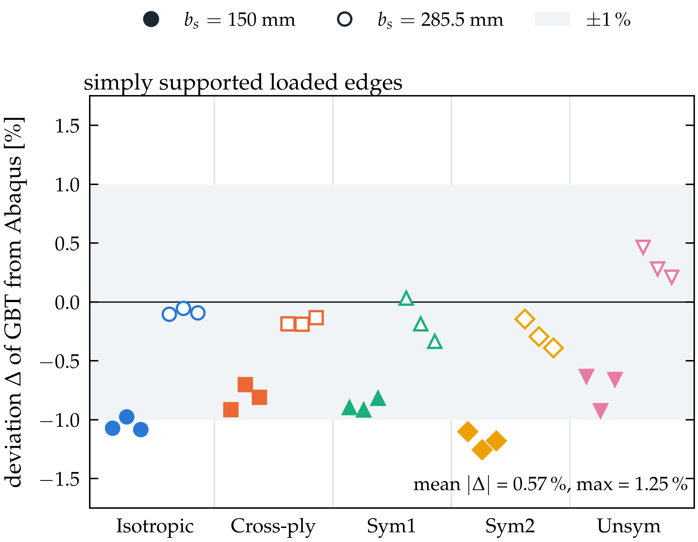
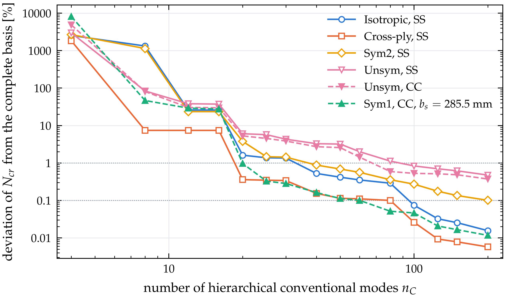

# Results and discussion

The formulation is verified against Abaqus shell models with periodic constraint equations, and the buckling behaviour of the cells is discussed. Tables 3 and 4 give the geometry, materials and lay-ups: an isotropic reference, a cross-ply laminate without coupling, two angle-ply laminates with bending–twisting coupling (Sym2 and the stringer of Sym1 also with $A_{16}, A_{26} \neq 0$) and an unsymmetric laminate with membrane–bending coupling. Two pitches, $b_s = 150$ mm and $285.5$ mm, and aspect ratios $0.5 \le \beta \le 3$ are considered first; longer cells follow in Section 3.5.

::: {custom-style="MDPI_4.1_table_caption"}
**Table 3.** Geometry of the cross-section (Figure 1) and material properties.
:::

| Parameter | Value |
|:--|:--|
| stringer pitch $b_s$ | 150 mm, 285.5 mm |
| web root half-width $b_3$, web height $h$, web inclination | 27.75 mm, 30 mm, 25° from the vertical |
| crown half-width $h_t = b_3 - h\tan 25^\circ$ | 13.76 mm |
| foot width $b_1 = 0.1\,(b_s - 2b_3)$ | 9.45 mm, 23.00 mm |
| skin and stringer thickness $t_s$, $t_f$ | 1.0 mm, 0.875 mm (8 and 7 plies of 0.125 mm) |
| stringer offset $c = (t_s+t_f)/2$ | 0.9375 mm |
| CFRP ply | $E_1 = 150$ GPa, $E_2 = 9$ GPa, $G_{12} = G_{13} = G_{23} = 5.3$ GPa, $\nu_{12} = 0.33$ |
| isotropic material | $E = 200$ GPa, $\nu = 0.3$ |

::: {custom-style="MDPI_4.1_table_caption"}
**Table 4.** Lay-ups of skin and stringer (angles in degrees from the $x$-axis).
:::

| Name | Skin | Stringer | Coupling |
|:--|:--|:--|:--|
| Isotropic | – | – | none |
| Cross-ply | [0/90/0/90]$_\mathrm{s}$ | [0/90/0/90/0/90/0] | none |
| Sym1 | [45/−45/−45/45]$_\mathrm{s}$ | [45/−45/45/−45/45/−45/45] | $D_{16}, D_{26}$ (stringer also $A_{16}, A_{26}$) |
| Sym2 | [60/−30/−30/60]$_\mathrm{s}$ | [60/−30/60/−30/60/−30/60] | $A_{16}, A_{26}, D_{16}, D_{26}$ |
| Unsym | [0/30/60/90]$_2$ | [0/30/60/90/0/30/60] | $\mathbf A$, $\mathbf B$, $\mathbf D$ fully populated |

A compressive line load of 1 N/mm acts at both loaded edges on skin, webs and crowns, and 2 N/mm on a foot (skin and flange) at the height of its resultant, so that $\lambda$ is the critical line load $N_{cr}$ in N/mm, as in the shell model. The shell models are linear buckling analyses in Abaqus with S4R/S3 elements and a seed of 3.7 mm; the stringer is tied to the skin by \*TIE with the true offset. Every skin node of the edge $X = -W$ is linked to the node of $X = 0$ at the same $x$ by one constraint equation per degree of freedom, Eq. (@pbc), omitting equations of degrees of freedom that are prescribed at the end corners. Simply supported (SS) loaded edges have $\mathcal U_2 = 0$ on every end node, with $\mathcal U_1 = \mathcal U_3 = 0$ at one corner against rigid-body motion. Clamped (CC) loaded edges have all six degrees of freedom fixed at $x = 0$ and all except $\mathcal U_3$ at $x = L$, where the load is applied; the flange end nodes follow the skin through the tie. GBT imposes the same conditions (Section 2.3.4).

## Verification

Every mode satisfies the periodic condition to round-off: for the cross-ply cell with $b_s = 150$ mm, the largest side-node differences over all conventional modes are $7.9\times10^{-15}$ (in-plane displacements), $1.1\times10^{-16}$ (rotation) and $2.3\times10^{-11}$ (warping), and zero for the shear and Mindlin modes; in the CC buckling mode of the Unsym cell they are of order $10^{-15}$ or smaller along the whole length, while the side edges move. The explicit tensors of Eqs. (@Cik)–(@couplingT) agree with the numerical cross-section integration of Eq. (@dU0) to $2\times10^{-15}$ for the Cross-ply, Sym2 and Unsym cells. Restricted to the classical limit, the Ritz solution reproduces the signature-curve minimum of Eq. (@signature) for the cross-ply cell, 33.747 N/mm with three half-waves for $L = 225$ mm and six for $L = 450$ mm, to 0.001 %.

## Pre-buckling state

Figure 3 shows the computed membrane forces for $b_s = 150$ mm and $\beta = 1.5$. At mid-length the axial force is $1.00$–$1.16\,n_0$ in the skin and $1.6$–$2.0\,n_0$ in the feet (skin and flange), after a transition zone near the loaded edges (Figure 3a,c). The transverse force (Figure 3b) is nearly uniform: $0.32\,n_0$ for the isotropic, $0.03$–$0.04\,n_0$ for the Cross-ply and Unsym, and $0.86$–$0.89\,n_0$ for the angle-ply cells. It is the force of a restrained Poisson expansion, since the periodic condition, like the constraint equations of the shell model, keeps the width of the cell constant; for the isotropic, Cross-ply and Sym1 skins $S_{ss}/S_{xx}$ agrees with $A_{12}/A_{11}$ to within 2 %. This compression enters $\mathbf G$ through Eq. (@Xgeo) and becomes decisive for long cells (Section 3.5). Clamping raises the axial force at $x = 0$, up to $1.43\,n_0$ in the skin bay of the Sym1 cell (Figure 3c,d).

{width=15.5cm}

## Critical loads of short cells

Figure 4 shows the critical loads as functions of $\beta$, Table 5 lists the 60 cases with their Abaqus counterparts, and Figure 5 shows the deviations. With SS loaded edges, GBT agrees with Abaqus within @@SSMEAN@@ % on average and @@SSMAX@@ % at most, with the same accuracy for uncoupled and coupled laminates (mean @@LAYMIN@@–@@LAYMAX@@ % for every lay-up). @@CC_TEXT@@ The SS curves of the isotropic, cross-ply and unsymmetric cells vary little with $\beta$ and show the garland maxima of plates, e.g. at $\beta = 0.75$ for the cross-ply cell with $b_s = 150$ mm (34.530 N/mm in GBT, 34.848 N/mm in Abaqus), which Abaqus confirms; the angle-ply cells decrease monotonically, because their skewed buckles cannot adapt to the straight loaded edges. Clamping raises the critical loads of short cells, by 59 % for the isotropic cell with $b_s = 150$ mm and $\beta = 0.5$, and all CC curves decrease monotonically.

{width=15.5cm}

::: {custom-style="MDPI_4.1_table_caption"}
**Table 5.** Critical loads $N_{cr}$ [N/mm] of the periodic cells: Abaqus, GBT and the deviation $e$ of GBT from Abaqus.
:::

@@TABNCR@@

The deviations depend mainly on the pitch: for $b_s = 285.5$ mm the SS mean deviation is @@M285@@ % (maximum @@X285@@ %), for $b_s = 150$ mm @@M150@@ % (maximum @@X150@@ %), with all 15 GBT results below Abaqus. This offset is not a truncation error, since the complete basis is used, nor a discretisation error of GBT, since finer segments lower the GBT result slightly (Section 3.7); it is attributed to differences between the plate model with link walls and the shell model with \*TIE in the short skin bays of the narrow pitch.

{width=15.5cm}

## Buckling modes and mode decomposition

All short cells buckle locally. For the Unsym cell with $b_s = 150$ mm and $\beta = 1.5$ (Figure 6), the skin bays buckle in three half-waves skewed by the laminate coupling with SS edges, and in two hardly skewed half-waves away from the clamped edges with CC edges; the stringers move only slightly, and the deflections at the two side edges are identical (difference $2.2\times10^{-16}$ of the maximum), so that the two half-bays join into a full bay. Over all short cells, Eq. (@rho) assigns 96–101 % of the strain energy to the local family, up to @@GMAX@@ % to the global family (largest for the cross-ply cell with $b_s = 285.5$ mm, whose wide bays buckle with a slight overall bending) and @@DMIN@@ % to @@DMAX@@ % to the distortional family; T and S contribute less than @@TSMMAX@@ % (Figure 7a–c). Values outside $[0, 100]$ % reflect interaction energies, e.g. small negative distortional contributions of the angle-ply cells.

{width=15.5cm}

In the manner of classical GBT, the hierarchical modes give a finer decomposition (Figure 7d–f). For the Unsym cell with SS edges, computed with the complete basis in hierarchical form ($N_{cr}$ = @@HN@@ N/mm, relative difference from the nodal basis @@HDIFF@@), the four modes @@HMODES@@ carry @@H4@@ % of the strain energy and the first 20 modes @@H20@@ %. They share the amplitude function with three half-waves and combine the bending of the skin bays with a small rotation and distortion of the stringers.

![**Figure 7.** Mode decomposition. (a)–(c) Participation $\rho_g$ of the families versus $\beta$ (upper part: local family; $\rho_M \equiv 0$): (a) Cross-ply, $b_s = 285.5$ mm, SS; (b) Unsym, $b_s = 150$ mm, SS; (c) Unsym, $b_s = 150$ mm, CC. (d) Participation $\rho_k$ of the first 60 hierarchical conventional modes ($k_r = \pi/b_s$) in the critical mode of the Unsym cell, $b_s = 150$ mm, $\beta = 1.5$, SS; (e) amplitude functions of the four dominant modes; (f) their in-plane shapes (grey: undeformed).](fig/fig07_participation.png){width=15.5cm}

## Long cells: change of the buckling mode

Figure 8 extends the SS cells with $b_s = 150$ mm to $\beta = 16$ ($L = 2400$ mm), and Figure 9 shows typical critical modes. Two different changes of the buckling mode occur, depending on the Poisson ratio of the skin.

The Cross-ply and Unsym cells, with small transverse membrane forces, buckle locally up to $\beta = 10$ (@@N:Cross-ply:10:1@@ and @@N:Unsym:10:1@@ N/mm) and globally from $\beta = 12$, with @@R:Unsym:12:1:G@@ % global participation (Figure 9c). The critical load then decreases as for an Euler column, for the Unsym cell from @@N:Unsym:12:1@@ N/mm at $\beta = 12$ to @@N:Unsym:16:1@@ N/mm at $\beta = 16$ (ratio @@RATIO:Unsym:12:16@@ against $(16/12)^2 = 1.78$), and local buckling becomes the second eigenvalue (@@N2:Unsym:12:1@@ N/mm). This local–global sequence, familiar from GBT analyses of members, here describes the overall buckling of the infinitely wide panel.

The isotropic and angle-ply cells switch from $\beta \approx 6$ to a mode with a much lower and monotonically decreasing critical load, e.g. for Sym1 @@N:Sym1:4:1@@, @@N:Sym1:8:1@@ and @@N:Sym1:16:1@@ N/mm at $\beta = 4$, 8 and 16. The skin forms one full wave across the cell, adjacent stringers deflect in opposite directions, and there is a single half-wave along the cell (Figure 9a), with about 85 % local and 15 % distortional participation. The mode has the period $2b_s$ ($\kappa b_s = \pi$, Section 2.2.5) and would be missed by a cell of one pitch. It is driven by the transverse force $S_{ss}$: when $S_{ss}$ is omitted from $\mathbf G$ (dashed lines in Figure 8a), the critical load of the isotropic cell with $\beta = 8$ rises from @@N:Isotropic:8:1@@ to @@N:Isotropic:8:0@@ N/mm with a local mode (Figure 9b), and the Sym1 cell buckles globally at @@N:Sym1:8:0@@ instead of @@N:Sym1:8:1@@ N/mm. Like a plate under transverse compression, whose critical load decreases with its length towards that of an infinitely long plate, the mode governs long cells, until the global mode, which is hardly affected by $S_{ss}$ (@@N2:Isotropic:12:1@@ against @@N:Isotropic:12:0@@ N/mm for the isotropic cell with $\beta = 12$), takes over at $\beta = 14$ for the isotropic cell.

This long-wave mode is a consequence of the constant width of the periodic cell, which the usual periodic constraint equations of shell models impose as well@@ABQLONG@@. A panel whose lateral expansion is free carries no such transverse force; approximated by omitting $S_{ss}$, its critical load is higher by a factor of up to @@FACTOR@@ (@@FACTORCASE@@). For long panels with high-Poisson skins, the choice between constant width and free expansion of the cell therefore decides the predicted critical load and mode, and the mode decomposition together with the pre-buckling state identifies this mechanism directly.

{width=15.5cm}

{width=15.5cm}

## Hierarchical mode bases

The complete periodic basis is equivalent to imposing the periodic condition node by node. Whether a small number of hierarchical modes suffices, as often in GBT, was examined by keeping the first $n_C$ hierarchical conventional modes ($k_r = \pi/b_s$) together with all shear and Mindlin modes, with the pre-buckling state of the complete basis (Figure 10). @@HCONV@@

{width=13.5cm}

## Accuracy, efficiency and limitations

The default discretisation (segments of at most $b_s/25$, spans $b_s/20$) was checked by refining each parameter in turn (Table 6). @@CONVTEXT@@

::: {custom-style="MDPI_4.1_table_caption"}
**Table 6.** Critical load $N_{cr}$ [N/mm] with the default discretisation and with refined spline spans or cross-section segments; in brackets the change from the default.
:::

@@TABCONV@@

A GBT analysis with the full basis of 482–569 modes, including cross-section analysis, pre-buckling solution and eigenvalue problem, takes @@TGSEQ@@ s on average for the ten cells with $b_s = 150$ mm and $\beta = 1.5$ on two cores (Table 7); the cross-section analysis itself takes about 0.1 s and is reused for all lengths. The GBT model has @@ABQRATIO@@ the degrees of freedom of the shell model, but its matrices are less sparse than those of a nodal model, because the global and distortional modes couple with all others. The benefit of the formulation therefore lies mainly in the modal description, rather than in the solution time of the full basis.

::: {custom-style="MDPI_4.1_table_caption"}
**Table 7.** Model size and computing time for $b_s = 150$ mm and $L = 225$ mm.
:::

| Model | Unknowns | Computing time per case |
|:--|:--|:--|
@@ABQROW@@
| GBT–Ritz (present) | 18 777 (569 modes × 33 splines) | @@TGSEQ@@ s on average |

The formulation rests on plate assumptions (Reissner–Mindlin walls with a shear correction factor of 5/6, link walls for the offset tie, linear buckling about a first-order state), which are the likely origin of the −1 % offset for $b_s = 150$ mm. The periodic condition keeps the cell width constant; it represents a panel whose lateral expansion is restrained, and a condition with free expansion requires one additional generalised coordinate (common jump of $U_X$), left for future work. A cell of width $2b_s$ admits $\kappa b_s = 0$ and $\pi$ only. Compact hierarchical bases are adequate for uncoupled laminates; coupled laminates require enriched bases.
