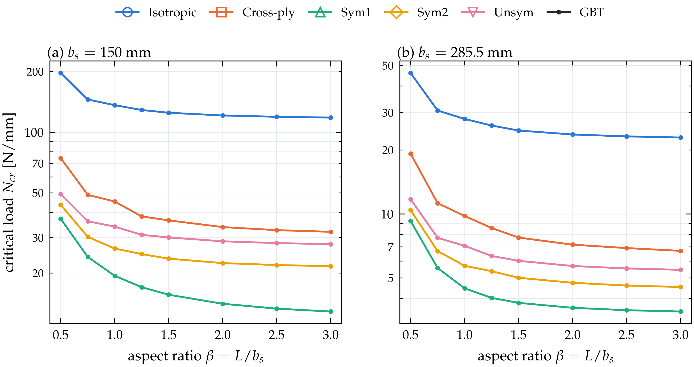

# Results and discussion

This section verifies the formulation and discusses the buckling behaviour of omega-stringer-stiffened panels with periodic side edges. The critical loads predicted by the GBT–Ritz formulation are compared with Abaqus shell models with periodic constraint equations for simply supported and clamped loaded edges. Particular attention is given to the critical loads, the buckling modes, the contribution of the individual deformation modes and the influence of the laminate coupling. The geometry of the cross-section and the material properties are summarised in Table 4, and the lay-ups in Table 5. They include an isotropic reference, a cross-ply laminate without coupling, two symmetric angle-ply laminates with bending–twisting coupling ($D_{16}, D_{26} \neq 0$; Sym2 and the seven-ply stringer of Sym1 also with $A_{16}, A_{26} \neq 0$), and an unsymmetric laminate with membrane–bending coupling ($\mathbf B \neq \mathbf 0$). Ply angles are measured from the stringer axis $x$. Two stringer pitches, $b_s = 150$ mm and $285.5$ mm, and aspect ratios $0.5 \le \beta \le 3$ are considered.

::: {custom-style="MDPI_4.1_table_caption"}
**Table 4.** Geometry of the cross-section (Figure 1) and material properties.
:::

| Parameter | Value |
|:--|:--|
| stringer pitch $b_s$ | 150 mm, 285.5 mm |
| web root half-width $b_3$, web height $h$, web inclination | 27.75 mm, 30 mm, 25° from the vertical |
| crown half-width $h_t = b_3 - h\tan 25^\circ$ | 13.76 mm |
| foot width $b_1 = 0.1\,(b_s - 2b_3)$ | 9.45 mm, 23.00 mm |
| skin and stringer thickness $t_s$, $t_f$ | 1.0 mm, 0.875 mm (8 and 7 plies of 0.125 mm) |
| stringer offset $c = (t_s+t_f)/2$ | 0.9375 mm |
| CFRP ply | $E_1 = 150$ GPa, $E_2 = 9$ GPa, $G_{12} = G_{13} = G_{23} = 5.3$ GPa, $\nu_{12} = 0.33$ |
| isotropic material | $E = 200$ GPa, $\nu = 0.3$ |

::: {custom-style="MDPI_4.1_table_caption"}
**Table 5.** Lay-ups of skin and stringer (angles in degrees from the $x$-axis; subscript s: symmetric, subscript 2: repeated twice).
:::

| Name | Skin | Stringer | Coupling |
|:--|:--|:--|:--|
| Isotropic | – | – | none |
| Cross-ply | [0/90/0/90]$_\mathrm{s}$ | [0/90/0/90/0/90/0] | none |
| Sym1 | [45/−45/−45/45]$_\mathrm{s}$ | [45/−45/45/−45/45/−45/45] | $D_{16}, D_{26}$ (stringer also $A_{16}, A_{26}$) |
| Sym2 | [60/−30/−30/60]$_\mathrm{s}$ | [60/−30/60/−30/60/−30/60] | $A_{16}, A_{26}, D_{16}, D_{26}$ |
| Unsym | [0/30/60/90]$_2$ | [0/30/60/90/0/30/60] | $\mathbf A$, $\mathbf B$, $\mathbf D$ fully populated |

A uniform compressive line load of 1 N/mm acts at both loaded edges on the skin, the webs and the crowns, and 2 N/mm on a foot, which carries skin and flange; the foot load acts at the height of its resultant, $Y = c/2$. The eigenvalue $\lambda$ is therefore the critical line load $N_{cr}$ in N/mm, the quantity reported by the buckling analysis of the shell model.

The shell models are linear buckling analyses in Abaqus with S4R and S3 elements and a seed of 3.7 mm. The stringer is tied to the skin by \*TIE with the true offset of the mid-surfaces, and the loads are applied as shell edge loads. The simply supported loaded edges are modelled by $\mathcal U_2 = 0$ on every end edge of skin and stringer. For the periodic side edges, every skin node of the edge $X = -W$ is paired with the node of $X = 0$ at the same $x$, and one constraint equation $\mathcal U_\alpha(-W,x) - \mathcal U_\alpha(0,x) = 0$ is written for each pair and each of the six degrees of freedom, as in Eq. (@pbc); at the two end corners the equation for $\mathcal U_2$ is omitted because $\mathcal U_2 = 0$ is already prescribed there. The rigid-body motions left by periodicity are removed by $\mathcal U_1 = \mathcal U_3 = 0$ at the corner $X = 0$, $x = 0$. The clamped loaded edges are modelled by $\mathcal U_1 = \mathcal U_2 = \mathcal U_3 = \mathcal{UR}_1 = \mathcal{UR}_2 = \mathcal{UR}_3 = 0$ on every end node at $x = 0$ and by the same conditions except $\mathcal U_3$ at $x = L$, where the edge load is applied; the end nodes of the flanges, which are tie-secondary nodes, follow the skin through the \*TIE, and at the periodic corner nodes only the equation for $\mathcal U_3$ at $x = L$ remains. The GBT model imposes the same physical conditions (Table 2).

## Verification of the formulation

Since the periodic condition is built into the modes, every buckling mode satisfies it identically. For the cross-ply cell with $b_s = 150$ mm, the largest difference between the two side nodes over all conventional modes is $7.9\times10^{-15}$ for the in-plane displacements, $1.1\times10^{-16}$ for the rotation $\theta$ and $2.3\times10^{-11}$ for the warping (modes scaled to a unit maximum), and it is zero for the shear and Mindlin modes. In the buckling mode of the Unsym panel with clamped loaded edges, $b_s = 150$ mm and $\beta = 1.5$, the largest differences between the side edges along the whole length are $1.2\times10^{-18}$ ($U_X$), $6.9\times10^{-18}$ ($U_Y$), $1.4\times10^{-20}$ ($\theta$) and $1.1\times10^{-15}$ (warping), with modal amplitudes of order $10^{-5}$ to $10^{-1}$, while the side edges themselves move.

The explicit modal tensors of Eqs. (@Cik)–(@couplingT) were compared with the cross-section integral of Eq. (@dU0) evaluated numerically by the implementation for the Cross-ply, Sym2 and Unsym cells; all blocks agree to within $2\times10^{-15}$ relative to their largest entry, i.e. to round-off. The classical limit of Section 2.3 was checked for the Cross-ply cell with $b_s = 150$ mm by restricting the model to the conventional modes and imposing a uniform compressive membrane force and the classical end condition $\varphi_i(0) = \varphi_i(L) = 0$. The B-spline Ritz solution then reproduces the minimum of the signature-curve eigenvalue problem of Eq. (@signature), 33.747 N/mm with three half-waves for $L = 225$ mm, to within 0.001 %; the same value is obtained for $L = 450$ mm with six half-waves.

## Pre-buckling state

Figure 3 shows the computed first-order membrane forces of the cells with $b_s = 150$ mm and $\beta = 1.5$, normalised by the reference load $n_0$. At mid-length (Figure 3a), the axial membrane force in the skin lies between $1.00\,n_0$ (Cross-ply, Unsym) and $1.16\,n_0$ (Sym1, Sym2), and the feet, which consist of skin and flange, carry about twice this value; the end load is thus redistributed between skin and stringer within a transition zone near the loaded edges (Figure 3c). The transverse membrane force (Figure 3b) is nearly uniform across the width and amounts to $0.32\,n_0$ for the isotropic cell, $0.04\,n_0$ and $0.03\,n_0$ for the Cross-ply and Unsym cells, and $0.86$–$0.89\,n_0$ for the angle-ply cells. It is the force of a restrained Poisson expansion: the periodic condition, like the constraint equations of the shell model, keeps the width of the cell constant, and for the isotropic, Cross-ply and Sym1 skins the ratio $S_{ss}/S_{xx}$ at mid-length agrees with $A_{12}/A_{11}$ of the skin laminate to within 2 %. The transverse compression is therefore part of the loading of the periodic panel and enters $\mathbf G$ through Eq. (@Xgeo); for the angle-ply cells, whose $\pm45^\circ$ and $60^\circ/{-30}^\circ$ plies have a large Poisson ratio, it is almost as large as the axial force, which contributes to their low critical loads. With clamped loaded edges (dashed lines in Figure 3c,d), the restraint of the in-plane end displacements raises the axial force at the clamped end $x = 0$, up to $1.43\,n_0$ in the skin bay of the Sym1 cell. At the end $x = L$, where the warping is free, the membrane forces of the angle-ply cells oscillate slightly within the last spline spans, consistent with the slower spline convergence of the clamped angle-ply cells reported in Section 3.8.

{width=15.5cm}

## Simply supported loaded edges

Figure 4 shows the critical load as a function of the aspect ratio for the two stringer pitches and all lay-ups, together with the Abaqus results, Table 6 lists all 30 cases that were computed with Abaqus, and Figure 5a shows the deviations case by case. GBT agrees with Abaqus within 0.57 % on average and 1.25 % at most. The accuracy is the same for the uncoupled and the coupled laminates (mean deviation 0.49–0.73 % for every lay-up), which confirms the treatment of the bending–twisting and membrane–bending coupling in Eqs. (@Cik)–(@couplingT).

{width=15.5cm}

For the isotropic, cross-ply and unsymmetric cells, the critical load varies only little with the aspect ratio, with local maxima where the length of the cell does not accommodate an integer number of buckle half-waves of the preferred length, as known from the garland curves of plates. For $b_s = 150$ mm such a maximum occurs at $\beta = 0.75$, and the Abaqus results follow it (cross-ply: 34.848 N/mm in Abaqus and 34.530 N/mm in GBT at $\beta = 0.75$, against 31.464 and 31.243 N/mm at $\beta = 1.5$). For the angle-ply cells Sym1 and Sym2, the critical load decreases monotonically with $\beta$ towards the value of the long cell. Their bending–twisting coupling skews the buckles, which therefore cannot adapt to the straight loaded edges by an integer number of half-waves, and the end conditions stiffen short cells.

::: {custom-style="MDPI_4.1_table_caption"}
**Table 6.** Critical loads $N_{cr}$ [N/mm] with periodic side edges and simply supported loaded edges: Abaqus and GBT, and the deviation $e$ of GBT from Abaqus.
:::

@@TABSS@@

The deviations depend mainly on the stringer pitch. For $b_s = 285.5$ mm the mean deviation of GBT is 0.20 % (maximum 0.46 %). For $b_s = 150$ mm it is 0.93 % (maximum 1.25 %), and all 15 GBT results lie below Abaqus (−1.25 % to −0.63 %, Figure 5a). The offset is not caused by a truncation of the mode basis, since the complete periodic basis is used, and the refinement study of Section 3.8 shows that it is not a discretisation error of GBT either, since finer segments lower the GBT result slightly. Its likely origins are differences between the S4R shell elements and the plate model in the short skin bays of the narrow pitch, and the representation of the tie; it has not been resolved in this study.

{width=15.5cm}

## Clamped loaded edges

The critical loads with clamped loaded edges are shown in Figure 6 and listed in Table 7. Clamping raises the critical load of short cells considerably, e.g. by 59 % for the isotropic cell with $b_s = 150$ mm and $\beta = 0.5$, and the curves decrease monotonically with $\beta$. For long cells the clamped values approach, and for some lay-ups fall slightly below, the simply supported ones (e.g. 118.13 against 121.41 N/mm for the isotropic cell with $\beta = 3$). In the present models the clamped edges also restrain the in-plane displacements of the loaded edges, which changes the pre-buckling state near the ends. @@CC_TEXT@@

{width=15.5cm}

::: {custom-style="MDPI_4.1_table_caption"}
**Table 7.** Critical loads $N_{cr}$ [N/mm] with periodic side edges and clamped loaded edges: Abaqus and GBT, and the deviation $e$ of GBT from Abaqus.
:::

@@TABCC@@

## Mode decomposition and buckling modes

Figure 7 shows the critical mode of the Unsym cell with $b_s = 150$ mm and $\beta = 1.5$ for both end conditions, as a view of the deformed cell and as the skin deflection. In both cases the mode is a local buckling of the skin bays between the stringers, which move only slightly, and the deflection at the side edges $X = -W$ and $X = 0$ is identical (largest difference $2.2\times10^{-16}$ of the maximum deflection), so that the half-bays at the two sides join into one full bay of the same shape as the central one. With simply supported loaded edges the skin bays buckle in three half-waves along the cell, skewed by the laminate coupling; with clamped loaded edges two half-waves form, which are concentrated away from the loaded edges and are hardly skewed.

{width=15.5cm}

The energy-based mode decomposition of Eq. (@rho) quantifies these observations for all panels (Table 8 and Figure 8a–c). In every case the local family carries 96–101 % of the strain energy of the critical mode, the global family up to @@GMAX@@ % and the distortional family between @@DMIN@@ % and @@DMAX@@ %; the transverse-extension and shear families contribute less than @@TSMMAX@@ %, and the Mindlin family contributes nothing by construction (Section 2.4). Contributions slightly above 100 % or below zero are possible in Eq. (@rho), because $U_g$ contains the interaction energy of family $g$ with the other families; small negative distortional contributions of the angle-ply laminates indicate that the distortional modes interact with the local skin buckles. The global participation is largest for the cross-ply cell with $b_s = 285.5$ mm, i.e. the local buckles of the wide skin bays are accompanied by a small overall bending of the cell. The decomposition does not change significantly with the aspect ratio, i.e. no transition to a distortional or global buckling mode occurs in the range studied. For the Unsym cell with simply supported loaded edges and $b_s = 150$ mm (Figure 8b), the global participation alternates between about 2 % and zero with $\beta$, i.e. between buckling modes with and without a small rigid-body translation of the cross-section, which corresponds to an overall bending of the panel.

The hierarchical modes of Section 2.2.5 allow a finer decomposition in the manner of classical GBT. Figure 8d shows the participation of the individual hierarchical conventional modes in the critical mode of the Unsym cell with simply supported loaded edges, $b_s = 150$ mm and $\beta = 1.5$, computed with the complete basis expressed in hierarchical modes ($N_{cr}$ = @@HN@@ N/mm, relative difference from the nodal basis @@HDIFF@@). Four modes, @@HMODES@@, carry @@H4@@ % of the strain energy, and the first 20 modes @@H20@@ %. Their amplitude functions (Figure 8e) have the same three half-waves, and their cross-section shapes (Figure 8f) combine the bending of the skin bays with a small rotation and distortion of the stringers. Such a diagram identifies the modes that a reduced basis must contain; the next section shows, however, that the many modes with small participation still affect the critical load of coupled laminates.

![**Figure 8.** Mode decomposition of the critical modes. (a)–(c) Energy-based participation $\rho_g$ of the mode families as a function of $\beta$ (upper part: local family; lower part: other families; the Mindlin participation vanishes identically): (a) Cross-ply, $b_s = 285.5$ mm, SS; (b) Unsym, $b_s = 150$ mm, SS; (c) Unsym, $b_s = 150$ mm, CC. (d) Participation $\rho_k$ of the first 60 hierarchical conventional modes (ordered at $k_r = \pi/b_s$) in the critical mode of the Unsym cell, $b_s = 150$ mm, $\beta = 1.5$, SS; (e) amplitude functions of the four dominant modes, scaled by the largest in-plane displacement of each mode shape; (f) in-plane shapes of these modes (grey: undeformed).](fig/fig08_participation.png){width=15.5cm}

::: {custom-style="MDPI_4.1_table_caption"}
**Table 8.** Energy-based participation $\rho_g$ [%] of the mode families in the critical mode, range over $0.5 \le \beta \le 3$ (eight aspect ratios).
:::

@@TABRHO@@

## Long cells: change of the buckling mode

The cells considered so far, with $\beta \le 3$, buckle locally. Figure 9 extends the simply supported cells with $b_s = 150$ mm to $\beta = 16$ ($L = 2400$ mm) and shows the participation of the local, distortional and global families; Figure 10 shows the corresponding critical modes. Two different changes of the buckling mode occur, depending on the Poisson ratio of the skin.

For the Cross-ply and Unsym cells, whose skins carry only small transverse membrane forces (Section 3.2), the critical load remains that of local skin buckling up to $\beta = 10$ (@@N:Cross-ply:10:1@@ and @@N:Unsym:10:1@@ N/mm). For longer cells the cell buckles globally: at $\beta = 12$ the global family carries @@R:Cross-ply:12:1:G@@ % (Cross-ply) and @@R:Unsym:12:1:G@@ % (Unsym) of the strain energy (Figure 10c), and the critical load decreases with the length as for an Euler column, e.g. for the Unsym cell from @@N:Unsym:12:1@@ N/mm at $\beta = 12$ to @@N:Unsym:16:1@@ N/mm at $\beta = 16$, a ratio of @@RATIO:Unsym:12:16@@ against $(16/12)^2 = 1.78$. The local mode then appears as the second eigenvalue (@@N2:Unsym:12:1@@ N/mm). This is the sequence from local to global buckling known from GBT analyses of members; here it describes the overall buckling of the infinitely wide panel between its loaded edges.

For the isotropic and the angle-ply cells, a different mode becomes critical from $\beta \approx 6$: the critical load falls far below the local value and decreases monotonically with the length, e.g. for Sym1 from @@N:Sym1:4:1@@ N/mm at $\beta = 4$ to @@N:Sym1:8:1@@ N/mm at $\beta = 8$ and @@N:Sym1:16:1@@ N/mm at $\beta = 16$. In this mode the skin forms one full wave across the cell, i.e. over two stringer pitches, so that adjacent stringers deflect in opposite directions, with a single half-wave along the cell (Figure 10a); the local family carries about 85 % and the distortional family about 15 % of the strain energy. The mode has the period $2b_s$ across the panel (Bloch wavenumber $\kappa b_s = \pi$, Section 2.2.5) and would therefore be missed by a cell of one stringer pitch. It is caused by the transverse membrane force $S_{ss}$ of the restrained Poisson expansion. When $S_{ss}$ is omitted from $\mathbf G$ (dashed lines in Figure 9a), the critical load of the isotropic cell with $\beta = 8$ rises from @@N:Isotropic:8:1@@ to @@N:Isotropic:8:0@@ N/mm and the cell buckles locally again (Figure 10b), and the Sym1 cell with $\beta = 8$ buckles globally at @@N:Sym1:8:0@@ instead of @@N:Sym1:8:1@@ N/mm. A skin bay under transverse compression buckles in one half-wave across the bay and long half-waves along the cell, and its critical load decreases with the length towards that of an infinitely long plate, which explains the shape of the curves. The global mode, which is hardly affected by $S_{ss}$ (isotropic cell with $\beta = 12$: second eigenvalue @@N2:Isotropic:12:1@@ N/mm with and @@N:Isotropic:12:0@@ N/mm without $S_{ss}$), becomes critical for the isotropic cell at $\beta = 14$ (@@N:Isotropic:14:1@@ N/mm).

The long-wave mode of the isotropic and angle-ply cells is therefore a consequence of the constant width of the periodic cell. The same constraint is contained in shell models with periodic constraint equations of the usual form (Section 3), which can therefore be expected to predict the same mode@@ABQLONG@@. A panel whose lateral expansion is not restrained carries no transverse membrane force of this kind and buckles at a much higher load, locally or globally. For long panels with skins of large Poisson ratio, the choice between a constant cell width and free lateral expansion thus decides the predicted critical load and mode, by a factor of @@FACTOR@@ for the Sym1 cell with $\beta = 8$ if the free expansion is approximated by omitting $S_{ss}$, and the GBT mode decomposition together with the pre-buckling state identifies this mechanism directly.

![**Figure 9.** Long periodic cells with simply supported loaded edges, $b_s = 150$ mm: (a) critical load as a function of the aspect ratio (logarithmic scales); solid lines: complete pre-buckling state; dashed lines: transverse membrane force $S_{ss}$ omitted from the geometric stiffness (isotropic and angle-ply cells)@@FIG9ABQ@@. (b)–(f) Energy-based participation of the local, distortional and global families in the critical mode (complete pre-buckling state). Spline spans $h_x = b_s/20 = 7.5$ mm, except for some cells with $\beta \ge 14$, computed with 9 or 10 mm because of the memory of the workstation (change of $N_{cr}$ below 0.01 % in a comparison at $\beta = 12$).](fig/fig09_long_cells.png){width=15.5cm}

![**Figure 10.** Critical modes of long periodic cells ($b_s = 150$ mm, simply supported loaded edges): oblique view of the deformed cell (amplitude exaggerated; colour: displacement normal to the walls) and deformed cross-section at the location of the largest displacement. (a) Isotropic, $\beta = 8$, complete pre-buckling state: long-wave mode driven by $S_{ss}$, with one wave of the skin across the cell and opposite deflections of adjacent stringers; (b) the same cell with $S_{ss}$ omitted: local skin buckling; (c) Unsym, $\beta = 16$: global buckling.](fig/fig10_long_modes.png){width=15.5cm}

## Hierarchical mode bases

The results above use the complete periodic mode basis, which is equivalent to imposing the periodic condition node by node in a folded-plate model with the same nodes. The characteristic feature of GBT is that a small number of hierarchically ordered modes suffices for many problems. This was examined with the hierarchical conventional modes of Section 2.2.5, ordered at $k_r = \pi/b_s$, the pre-buckling state of the complete basis and the end conditions of Section 2.3.5. Table 9 and Figure 11 show the deviation of the critical load when only the first $n_C$ hierarchical conventional modes are kept, together with all shear and Mindlin modes, and Table 9 also the deviation when the Mindlin modes are omitted from the complete basis.

::: {custom-style="MDPI_4.1_table_caption"}
**Table 9.** Deviation [%] of the critical load from the complete basis for truncated mode bases ($\beta = 1.5$): the first $n_C$ hierarchical conventional modes with all shear and Mindlin modes, and all conventional and shear modes without the Mindlin modes.
:::

@@TABRED@@

@@REDTEXT@@

{width=13.5cm}

@@HCONV@@

## Accuracy and efficiency

The default discretisation (segments of at most $b_s/25$, spline spans $h_x = b_s/20$) was checked by refining each parameter in turn (Table 10). @@CONVTEXT@@

::: {custom-style="MDPI_4.1_table_caption"}
**Table 10.** Critical load $N_{cr}$ [N/mm] with the default discretisation and with refined spline spans or cross-section segments (periodic side edges); in brackets the change from the default.
:::

@@TABCONV@@

The model sizes and computing times are compared in Table 11. With the full basis of 482–569 modes, a GBT analysis, including the cross-section analysis, the pre-buckling solution and the eigenvalue problem, takes @@TGSEQ@@ s on average for the ten cells with $b_s = 150$ mm and $\beta = 1.5$ on two cores of a standard workstation; over all 160 cases of Figures 4 and 6, computed two at a time on the same two cores, it ranged from @@TMIN@@ to @@TMAX@@ s. The GBT model has @@ABQRATIO@@ the degrees of freedom of the shell model. Its matrices are, however, less sparse than those of a nodal model, because the global and distortional modes extend over the whole cross-section and couple with all other modes, so that the saving in solution time is smaller than the saving in unknowns. The cross-section analysis itself takes about 0.1 s and is reused for all lengths of a parametric study. The efficiency of the GBT formulation therefore lies in its modal description, which provides the mode decomposition and is the basis for reduced mode sets, rather than in the solution time of the full basis.

::: {custom-style="MDPI_4.1_table_caption"}
**Table 11.** Model size and computing time for $b_s = 150$ mm and $L = 225$ mm.
:::

| Model | Unknowns | Computing time per case |
|:--|:--|:--|
@@ABQROW@@
| GBT–Ritz (present) | 18 777 (569 modes × 33 splines) | @@TGSEQ@@ s on average |

The following limitations should be noted. First, GBT rests on plate assumptions: laminated Reissner–Mindlin walls with a shear correction factor of 5/6, an offset tie represented by stiff link walls, and linear buckling about a first-order pre-buckling state; differences between these assumptions and the shell model are the likely origin of the −1 % offset for $b_s = 150$ mm. Second, the periodic condition of Eq. (@pbc), like the constraint equations of the shell model, keeps the width of the cell constant. The Poisson expansion of the cell under the axial load is therefore restrained, and transverse membrane forces $S_{ss}$ arise in the pre-buckling state; for the isotropic cell with $b_s = 150$ mm and $\beta = 3$, omitting $S_{ss}$ from $\mathbf G$ would raise the critical load by 23 %. The condition thus represents a panel whose lateral expansion is restrained by the surrounding structure; for long cells with skins of large Poisson ratio this restraint changes the critical mode (Section 3.6). A periodic condition with free lateral expansion, in which the two side edges differ by a common jump in $U_X$, requires one additional generalised coordinate and is left for future work. Third, a cell of width $2b_s$ admits the Bloch wavenumbers $\kappa b_s = 0$ and $\pi$ only; buckling modes with a longer period across the stringers require a wider cell. Fourth, compact hierarchical bases are adequate for the uncoupled laminates only (Section 3.7); for the coupled laminates, enriched bases remain to be developed.
