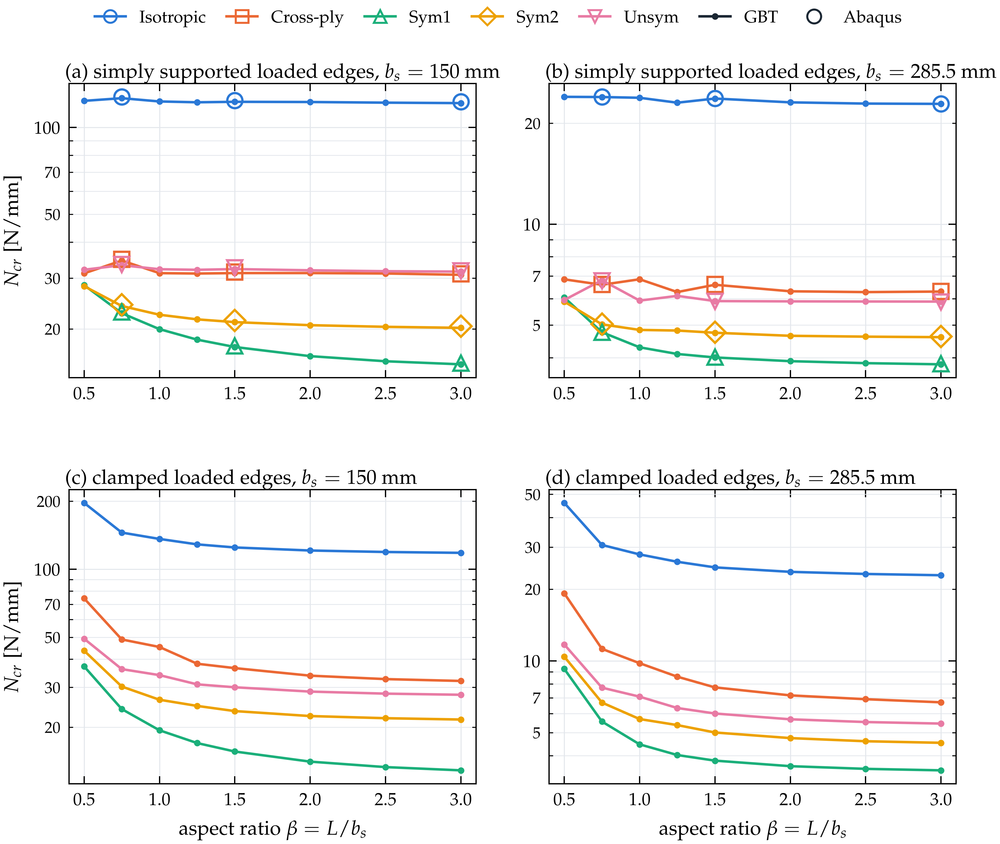
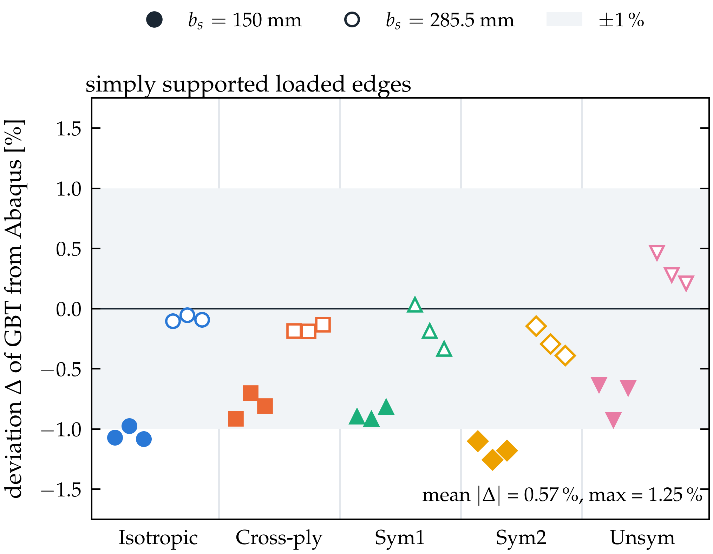
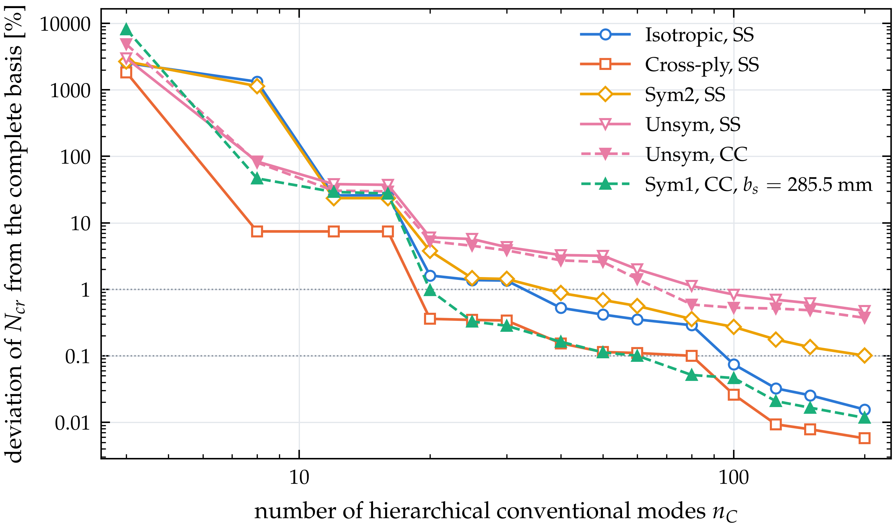

# Results and discussion

After a verification (Section 3.1) and the pre-buckling state (Section 3.2), critical loads and modes are compared with Abaqus shell models (Sections 3.3–3.5), followed by truncated bases (Section 3.6) and accuracy, cost and limitations (Section 3.7). Tables 3 and 4 give the geometry, materials and lay-ups: an isotropic reference, an uncoupled cross-ply laminate, two angle-ply laminates with bending–twisting coupling and an unsymmetric laminate with membrane–bending coupling. The pitches $b_s = 150$ mm and $285.5$ mm with $0.5 \le \beta \le 3$ are considered first; longer cells follow in Section 3.5.

::: {custom-style="MDPI_4.1_table_caption"}
**Table 3.** Geometry of the cross-section (Figure 1) and material properties (CFRP: carbon fibre-reinforced polymer).
:::

| Parameter | Value |
|:--|:--|
| stringer pitch $b_s$ | 150 mm, 285.5 mm |
| web root half-width $b_3$, web height $h_w$, web inclination | 27.75 mm, 30 mm, 25° from the vertical |
| crown half-width $b_t = b_3 - h_w\tan 25^\circ$ | 13.76 mm |
| foot width $b_1 = 0.1\,(b_s - 2b_3)$ | 9.45 mm, 23.00 mm |
| skin and stringer thickness $t_s$, $t_f$ | 1.0 mm, 0.875 mm (8 and 7 plies of 0.125 mm) |
| stringer offset $c = (t_s+t_f)/2$ | 0.9375 mm |
| CFRP ply | $E_1 = 150$ GPa, $E_2 = 9$ GPa, $G_{12} = G_{13} = G_{23} = 5.3$ GPa, $\nu_{12} = 0.33$ |
| isotropic material | $E = 200$ GPa, $\nu = 0.3$ |

::: {custom-style="MDPI_4.1_table_caption"}
**Table 4.** Lay-ups of skin and stringer (angles in degrees from the $x$-axis).
:::

| Name | Skin | Stringer | Coupling |
|:--|:--|:--|:--|
| Isotropic | – | – | none |
| Cross-ply | [0/90/0/90]$_\mathrm{s}$ | [0/90/0/90/0/90/0] | none |
| Sym1 | [45/−45/−45/45]$_\mathrm{s}$ | [45/−45/45/−45/45/−45/45] | $D_{16}, D_{26}$ (stringer also $A_{16}, A_{26}$) |
| Sym2 | [60/−30/−30/60]$_\mathrm{s}$ | [60/−30/60/−30/60/−30/60] | $A_{16}, A_{26}, D_{16}, D_{26}$ |
| Unsym | [0/30/60/90]$_2$ | [0/30/60/90/0/30/60] | $\mathbf A$, $\mathbf B$, $\mathbf D$ fully populated |

In both models, a line load of 1 N/mm compresses both loaded edges of skin, webs and crowns, and 2 N/mm a foot (two edges: skin and flange) at the height of their resultant, so that $\lambda$ is directly $N_{cr}$ in N/mm. The shell models are those of {{elsayed2026,elyaakoubi2025}} (geometry, S4R/S3 elements with a seed of 3.7 mm, stringer tied to the skin by \*TIE with the true offset $c$), extended here by periodic constraint equations; they are linear buckling analyses in Abaqus/Standard [version to be added]. Eq. (@pbc) links every skin node of the edge $X = -W$ to the node of $X = 0$ at the same $x$ by one constraint equation per degree of freedom, except for degrees of freedom already prescribed at the end corners. Simply supported (SS) loaded edges have $\mathcal U_2 = 0$ on every end node, with $\mathcal U_1 = \mathcal U_3 = 0$ at one corner; clamped (CC) loaded edges have all six degrees of freedom fixed at $x = 0$ and all except $\mathcal U_3$ at $x = L$, where the load is applied. GBT imposes the same conditions (Section 2.3.4). The GBT–Ritz analysis was implemented in Python 3.13 (NumPy 2.5, SciPy 1.18). Claude (Anthropic) [model version to be confirmed] assisted in code development, post-processing, figure generation and drafting of the text; all derivations, code and results were checked by the authors (Section 3.1). The deviation of GBT from Abaqus is $e = (N_{cr}^{\mathrm{GBT}} - N_{cr}^{\mathrm{Abaqus}})/N_{cr}^{\mathrm{Abaqus}}$, and modes are compared by the modal assurance criterion $\mathrm{MAC} = (\mathbf w_{\mathrm{GBT}}^{\mathsf T}\mathbf w_{\mathrm{Abq}})^2/[(\mathbf w_{\mathrm{GBT}}^{\mathsf T}\mathbf w_{\mathrm{GBT}})(\mathbf w_{\mathrm{Abq}}^{\mathsf T}\mathbf w_{\mathrm{Abq}})]$ of the skin deflections at all skin nodes of the shell model ($\mathbf w_{\mathrm{Abq}}$) and of GBT interpolated to them ($\mathbf w_{\mathrm{GBT}}$); MAC = 1 means identical shapes.

## Verification

Three checks confirm the implementation. Every mode is periodic to round-off: for the cross-ply cell with $b_s = 150$ mm, the largest side-node differences of the conventional modes are $7.9\times10^{-15}$ (in-plane displacements), $1.1\times10^{-16}$ (rotation) and $2.3\times10^{-11}$ (warping), and zero for the shear and Mindlin modes. The explicit tensors of Eqs. (@Cik)–(@couplingT) agree with the numerical cross-section integration of Eq. (@Xide) to $2\times10^{-15}$, and, in the classical limit (Section 2.3.4), the Ritz solution reproduces the signature-curve minimum of Eq. (@signature) for the cross-ply cell (33.747 N/mm, three half-waves for $L = 225$ mm and six for $L = 450$ mm) to 0.001 %.

## Pre-buckling state

Figure 3 shows the computed membrane forces for $b_s = 150$ mm and $\beta = 1.5$. Away from the loaded edges the axial force is $1.00$–$1.16\,n_0$ in the skin and $1.6$–$2.0\,n_0$ in the feet (Figure 3a,c), and the transverse force (Figure 3b) is nearly uniform: $0.32\,n_0$ for the isotropic, $0.03$–$0.04\,n_0$ for the Cross-ply and Unsym, and $0.86$–$0.89\,n_0$ for the angle-ply cells. It results from the restrained Poisson expansion: the compressed skin tends to expand laterally, but the periodic condition, like the shell model's constraint equations, keeps the cell width constant, so that $S_{ss} \approx (A_{12}/A_{11})\,S_{xx}$; for the isotropic, Cross-ply and Sym1 skins the ratio agrees within 2 %, and the angle-ply values are large because of their large $A_{12}$. This compression enters $\mathbf G$ through Eq. (@Xgeo) and becomes decisive for long cells (Section 3.5). Clamping raises the axial force at $x = 0$, up to $1.43\,n_0$ in the skin bay of the Sym1 cell (Figure 3c,d).

{width=15.5cm}

## Critical loads of short cells

Figure 4 and Table 5 give the critical loads of the 60 cases, and Figure 5 the deviations from Abaqus. With SS loaded edges, GBT agrees with Abaqus within 0.57 % on average and 1.25 % at most, with the same accuracy for uncoupled and coupled laminates (mean 0.49–0.73 % for every lay-up). With CC loaded edges the deviations are 0.64 % on average and 1.52 % at most. The SS curves of the isotropic, cross-ply and unsymmetric cells vary little with $\beta$, with the garland maxima of plates where the number of half-waves changes (e.g. $\beta = 0.75$, cross-ply, $b_s = 150$ mm); the angle-ply curves decrease monotonically, because skewed buckles cannot adapt to straight loaded edges. Clamping raises the critical loads of short cells, by 59 % for the isotropic cell with $b_s = 150$ mm and $\beta = 0.5$, and all CC curves decrease monotonically.

{width=15.5cm}

::: {custom-style="MDPI_4.1_table_caption"}
**Table 5.** Critical loads $N_{cr}$ [N/mm] of the periodic cells: Abaqus, GBT and the deviation $e = (N_{cr}^{\mathrm{GBT}} - N_{cr}^{\mathrm{Abaqus}})/N_{cr}^{\mathrm{Abaqus}}$.
:::

| Lay-up | $b_s$ [mm] | $\beta$ | SS: Abaqus | SS: GBT | SS: $e$ [%] | CC: Abaqus | CC: GBT | CC: $e$ [%] |
|:--|--:|--:|--:|--:|--:|--:|--:|--:|
| Isotropic | 150 | 0.75 | 127.650 | 126.284 | −1.07 | 146.600 | 145.225 | −0.94 |
|  | 150 | 1.5 | 123.880 | 122.674 | −0.97 | 126.100 | 124.801 | −1.03 |
|  | 150 | 3 | 122.740 | 121.412 | −1.08 | 119.420 | 118.133 | −1.08 |
|  | 285.5 | 0.75 | 23.979 | 23.954 | −0.10 | 30.678 | 30.646 | −0.11 |
|  | 285.5 | 1.5 | 23.720 | 23.707 | −0.05 | 24.713 | 24.675 | −0.15 |
|  | 285.5 | 3 | 22.873 | 22.852 | −0.09 | 22.913 | 22.870 | −0.19 |
| Cross-ply | 150 | 0.75 | 34.848 | 34.530 | −0.91 | 49.330 | 48.878 | −0.92 |
|  | 150 | 1.5 | 31.464 | 31.243 | −0.70 | 36.806 | 36.503 | −0.82 |
|  | 150 | 3 | 31.061 | 30.810 | −0.81 | 32.275 | 32.027 | −0.77 |
|  | 285.5 | 0.75 | 6.607 | 6.595 | −0.18 | 11.250 | 11.228 | −0.19 |
|  | 285.5 | 1.5 | 6.609 | 6.597 | −0.19 | 7.749 | 7.737 | −0.16 |
|  | 285.5 | 3 | 6.304 | 6.296 | −0.13 | 6.709 | 6.699 | −0.16 |
| Sym1 | 150 | 0.75 | 22.880 | 22.675 | −0.90 | 24.199 | 24.047 | −0.63 |
|  | 150 | 1.5 | 17.475 | 17.315 | −0.92 | 15.825 | 15.606 | −1.38 |
|  | 150 | 3 | 15.202 | 15.078 | −0.82 | 13.077 | 12.882 | −1.49 |
|  | 285.5 | 0.75 | 4.760 | 4.762 | +0.03 | 5.572 | 5.564 | −0.15 |
|  | 285.5 | 1.5 | 4.011 | 4.004 | −0.18 | 3.849 | 3.813 | −0.94 |
|  | 285.5 | 3 | 3.832 | 3.819 | −0.33 | 3.501 | 3.472 | −0.84 |
| Sym2 | 150 | 0.75 | 24.291 | 24.024 | −1.10 | 30.485 | 30.252 | −0.76 |
|  | 150 | 1.5 | 21.386 | 21.118 | −1.25 | 23.877 | 23.563 | −1.31 |
|  | 150 | 3 | 20.415 | 20.174 | −1.18 | 21.954 | 21.619 | −1.52 |
|  | 285.5 | 0.75 | 5.033 | 5.026 | −0.14 | 6.679 | 6.683 | +0.06 |
|  | 285.5 | 1.5 | 4.758 | 4.744 | −0.29 | 5.021 | 5.005 | −0.32 |
|  | 285.5 | 3 | 4.620 | 4.602 | −0.39 | 4.557 | 4.530 | −0.59 |
| Unsym | 150 | 0.75 | 33.489 | 33.277 | −0.63 | 36.370 | 36.129 | −0.66 |
|  | 150 | 1.5 | 32.561 | 32.260 | −0.92 | 30.238 | 30.030 | −0.69 |
|  | 150 | 3 | 31.825 | 31.616 | −0.66 | 28.027 | 27.821 | −0.73 |
|  | 285.5 | 0.75 | 6.775 | 6.806 | +0.46 | 7.707 | 7.718 | +0.14 |
|  | 285.5 | 1.5 | 5.880 | 5.897 | +0.28 | 6.002 | 6.013 | +0.19 |
|  | 285.5 | 3 | 5.864 | 5.876 | +0.21 | 5.446 | 5.455 | +0.17 |

The deviations depend mainly on the pitch: for $b_s = 285.5$ mm the SS mean deviation is 0.21 % (maximum 0.46 %), for $b_s = 150$ mm 0.93 % (maximum 1.25 %), with all 15 GBT results below Abaqus. This offset is not a truncation error (the complete basis is used), not a discretisation error of GBT (finer segments lower the GBT result further, Table 6) and not caused by flexible link walls (stiffer links leave it unchanged, Section 3.7). It is most likely due to the different modelling of the stringer–skin junction (one combined foot laminate with link walls in GBT, two shells tied by \*TIE in Abaqus), which governs a larger part of the buckle in the short skin bays of the narrow pitch; closed-form models of the same panels also deviate most from shell models for $b_s = 150$ mm {{elyaakoubi2024wccm}}.

{width=15.5cm}

## Buckling modes and mode decomposition

All short cells buckle locally. For the Unsym cell with $b_s = 150$ mm and $\beta = 1.5$ (Figure 6), with MAC = 0.9998 (SS) and 0.9999 (CC) between GBT and Abaqus, the skin bays buckle in three skewed half-waves (SS) or two hardly skewed ones (CC), and the stringers move only slightly. Over all short cells, Eq. (@rho) assigns 96–101 % to the local family, up to 3.5 % to the global family (cross-ply cell with $b_s = 285.5$ mm) and −1.6 % to 1.1 % to the distortional family; T and S contribute less than 0.1 % (Figure 7a–c). Values slightly outside 0–100 % stem from coupling energies, which can be negative.

{width=15.5cm}

The hierarchical modes (Section 2.2.5) give a finer decomposition, in the manner of classical GBT (Figure 7d–f). For the Unsym cell with SS edges, computed with the complete basis in hierarchical form ($N_{cr}$ = 32.26 N/mm, relative difference from the nodal basis $1.3\times10^{-10}$), the four modes 12, 18, 8 and 20 carry 96.5 % of the strain energy and the first 20 modes 97.9 %.

{width=15.5cm}

## Long cells: change of the buckling mode

Figure 8 extends the SS cells with $b_s = 150$ mm to $\beta = 16$ ($L = 2400$ mm), and Figure 9 shows typical modes. The change of the mode depends on $A_{12}/A_{11}$ of the skin, which sets $S_{ss}$ (Section 3.2).

The Cross-ply and Unsym cells (small $S_{ss}$) buckle locally up to $\beta = 10$ (30.61 and 31.44 N/mm) and globally from $\beta = 12$, with 99.9 % global participation (Figure 9c); the load then decreases as for an Euler column, for the Unsym cell from 22.41 N/mm at $\beta = 12$ to 12.71 N/mm at $\beta = 16$ (ratio 1.76 against $(16/12)^2 = 1.78$), and local buckling becomes the second eigenvalue (31.43 N/mm).

The isotropic and angle-ply cells switch from $\beta \approx 6$ to a mode with a much lower, decreasing critical load, e.g. for Sym1 14.69, 5.20 and 4.40 N/mm at $\beta = 4$, 8 and 16. The skin forms one full wave across the cell and one half-wave along it, adjacent stringers deflecting oppositely (Figure 9a; about 85 % local, 15 % distortional). This mode has the period $2b_s$ ($k_B b_s = \pi$, Section 2.2.5) and would be missed by a cell of one pitch. It is driven by $S_{ss}$: without $S_{ss}$ in $\mathbf G$ (dashed lines in Figure 8a), the critical load of the isotropic cell with $\beta = 8$ rises from 75.09 to 148.72 N/mm with a local mode (Figure 9b), and the Sym1 cell buckles globally at 17.73 instead of 5.20 N/mm. As for a plate under transverse compression, the load decreases with the length until the global mode, which is hardly affected by $S_{ss}$ (72.28 against 72.33 N/mm at $\beta = 12$), takes over at $\beta = 14$ for the isotropic cell.

Abaqus confirms both mechanisms: with constant width it gives 75.32 and 5.22 N/mm for the long-wave modes (isotropic, Sym1, $\beta = 8$) and 22.37 and 22.29 N/mm for the global modes (Unsym, $\beta = 12$; Cross-ply, $\beta = 14$), within 0.46 % of GBT and with MAC $\ge$ 0.9999 (Figures 8a and 9). The long-wave mode is thus caused by the constant cell width, which periodic shell models impose as well. If the shell model lets the cell expand laterally (common jump of $\mathcal U_1$ and $\mathcal U_3$ between the side edges), the isotropic cell with $\beta = 8$ buckles locally at 152.44 N/mm and the Sym1 cell globally at 15.40 N/mm, i.e. 2.0 and 2.9 times higher than with constant width. Omitting $S_{ss}$ in GBT reproduces the local case within 2.4 % but overestimates the global load of the Sym1 cell by 15 %, probably because the free model also releases the in-plane shear (common jump of $\mathcal U_3$); free expansion in GBT requires additional generalised coordinates for these jumps and is left for future work. Constant width, as in periodic shell models, is thus conservative for panels that can expand laterally, whereas omitting $S_{ss}$, as models that prescribe only the axial load implicitly do, is not conservative in general (Sym1 cell: +15 %).

{width=15.5cm}

{width=15.5cm}

## Hierarchical mode bases

Whether a few modes suffice, as often in GBT, was examined by keeping the first $n_C$ hierarchical conventional modes ($k_r = \pi/b_s$) together with all shear and Mindlin modes, with the pre-buckling state of the complete basis (Figure 10). The convergence is stepwise; the four modes from $n_C = 17$ to 20 reduce the deviation by a factor of 6 to 29. A deviation below 1 % requires 20 to 40 modes for the isotropic, cross-ply and angle-ply cells, but 80 to 100 of the 273 modes for the unsymmetric cell. Omitting the Mindlin modes raises the critical load by 0.36 % to 2.01 %. A classical small basis (20 conventional modes, their warping at $k_r$, no Mindlin modes; 41 modes) gives +1.45 % for the isotropic cell with $b_s = 285.5$ mm and $\beta = 0.75$, but +10.36 % for the Unsym cell with SS edges.

{width=13.5cm}

## Accuracy, efficiency and limitations

The default discretisation (segments of at most $b_s/25$, spans $b_s/20$) was checked by refining each parameter in turn (Table 6). All changes are within 0.50 %, except for the Sym1 cell with CC edges, $b_s = 285.5$ mm and $\beta = 1.5$, for which halving the spans repeatedly raises the critical load by +0.26, +0.47 and +0.62 %, lowering its deviation from Abaqus from −0.94 to −0.32 %. The critical load depends neither on the link-wall factor (122.667, 122.674 and 122.671 N/mm for $k_L = 10^2$, $10^3$, $10^4$; isotropic cell, SS, $\beta = 1.5$) nor on the soft factor of Eq. (@link) (122.684 to 122.673 N/mm for $10^{-2}$ to 0), whereas a stiff twisting term $D^L_{66} = k_L D_{0,66}$ would lock the web roots (+22.8 %).

::: {custom-style="MDPI_4.1_table_caption"}
**Table 6.** $N_{cr}$ [N/mm] with the default and refined discretisations (change in brackets).
:::

| Case | Default | Spans $h_x/2$ | Segments $b_s/40$ |
|:--|--:|--:|--:|
| Isotropic, SS, $b_s = 150$, $\beta = 1.5$ | 122.6740 | 122.5921 (−0.07 %) | 122.4080 (−0.22 %) |
| Sym2, SS, $b_s = 150$, $\beta = 3$ | 20.1744 | 20.1776 (+0.02 %) | 20.1476 (−0.13 %) |
| Unsym, CC, $b_s = 150$, $\beta = 1.5$ | 30.0295 | 30.0275 (−0.01 %) | 29.8795 (−0.50 %) |
| Sym1, CC, $b_s = 285.5$, $\beta = 3$ | 3.4715 | 3.4780 (+0.19 %) | 3.4698 (−0.05 %) |
| Sym1, CC, $b_s = 285.5$, $\beta = 1.5$ | 3.8130 | 3.8230 (+0.26 %) | 3.8100 (−0.08 %) |

A complete GBT analysis with 474–558 modes takes 4.6 s on average for the ten cells with $b_s = 150$ mm and $\beta = 1.5$, of which the cross-section analysis, reused for all lengths, takes less than 1 s. For the four long cells of Table 7, GBT has about 32 % of the degrees of freedom of the shell model and needs 24–51 % of its time (different two-core machines); since the global and distortional modes couple with all others, the GBT matrices are less sparse, and the main benefit is the modal description.

::: {custom-style="MDPI_4.1_table_caption"}
**Table 7.** Model size and computing time of the long cells (SS, $b_s = 150$ mm; Abaqus: 8 eigenvalues, time of the solver step, Intel i5-13420H; GBT: 2 eigenvalues and mode decomposition, Intel Xeon 2.1 GHz; 2 cores each).
:::

| Cell | Abaqus DOFs | Abaqus time [s] | GBT unknowns | GBT time [s] |
|:--|--:|--:|--:|--:|
| Isotropic, $\beta = 8$ | 282,750 | 167 | 90,770 | 61 |
| Sym1, $\beta = 8$ | 282,750 | 146 | 90,770 | 35 |
| Unsym, $\beta = 12$ | 423,690 | 492 | 135,410 | 132 |
| Cross-ply, $\beta = 14$ | 495,030 | 208 | 157,730 | 106 |

The plate assumptions (Reissner–Mindlin walls, link walls for the tie, linear buckling about a first-order state) are the likely origin of the −1 % offset for $b_s = 150$ mm, and the formulation represents panels whose lateral expansion is restrained (Section 3.5).
