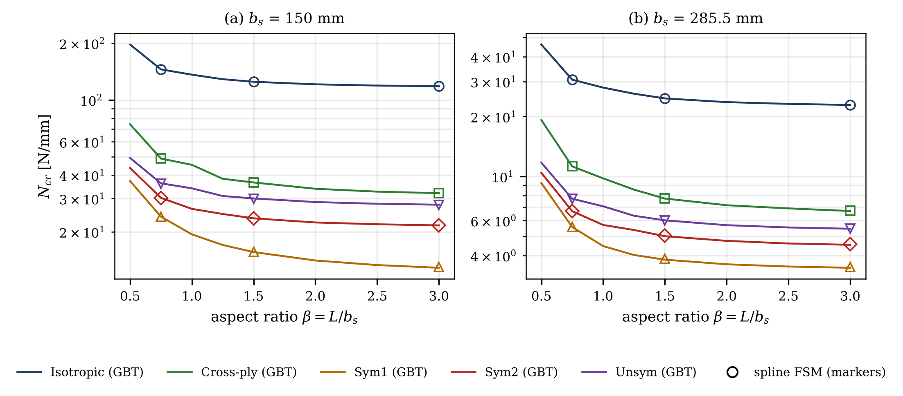
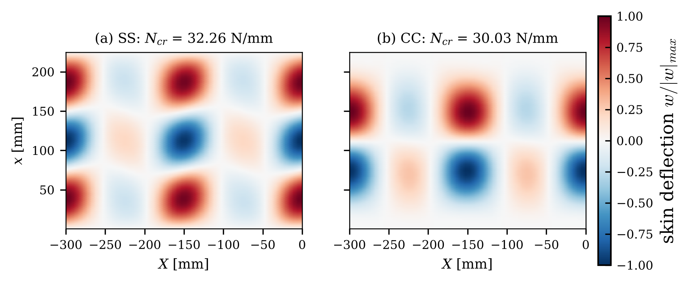

# Results and discussion

This section verifies the formulation and discusses the buckling behaviour of omega-stringer-stiffened panels with periodic side edges. The critical loads predicted by the GBT–Ritz formulation are compared with Abaqus shell models with periodic constraint equations for simply supported loaded edges and with an independent spline finite strip model for clamped loaded edges. Particular attention is given to the critical loads, the buckling modes, the contribution of the individual deformation modes and the influence of the laminate coupling. The geometry of the cross-section and the material properties are summarised in Table 4, and the lay-ups in Table 5. They include an isotropic reference, a cross-ply laminate without coupling, two symmetric angle-ply laminates with bending–twisting coupling ($D_{16}, D_{26} \neq 0$; Sym2 and the seven-ply stringer of Sym1 also with $A_{16}, A_{26} \neq 0$), and an unsymmetric laminate with membrane–bending coupling ($\mathbf B \neq \mathbf 0$). Ply angles are measured from the stringer axis $x$. Two stringer pitches, $b_s = 150$ mm and $285.5$ mm, and aspect ratios $0.5 \le \beta \le 3$ are considered.

::: {custom-style="MDPI_4.1_table_caption"}
**Table 4.** Geometry of the cross-section (Figure 1) and material properties.
:::

| Parameter | Value |
|:--|:--|
| stringer pitch $b_s$ | 150 mm, 285.5 mm |
| web root half-width $b_3$, web height $h$, web inclination | 27.75 mm, 30 mm, 25° from the vertical |
| crown half-width $h_t = b_3 - h\tan 25^\circ$ | 13.76 mm |
| foot width $b_1 = 0.1\,(b_s - 2b_3)$ | 9.45 mm, 23.00 mm |
| skin and stringer thickness $t_s$, $t_f$ | 1.0 mm, 0.875 mm (8 and 7 plies of 0.125 mm) |
| stringer offset $c = (t_s+t_f)/2$ | 0.9375 mm |
| CFRP ply | $E_1 = 150$ GPa, $E_2 = 9$ GPa, $G_{12} = G_{13} = G_{23} = 5.3$ GPa, $\nu_{12} = 0.33$ |
| isotropic material | $E = 200$ GPa, $\nu = 0.3$ |

::: {custom-style="MDPI_4.1_table_caption"}
**Table 5.** Lay-ups of skin and stringer (angles in degrees from the $x$-axis; subscript s: symmetric, subscript 2: repeated twice).
:::

| Name | Skin | Stringer | Coupling |
|:--|:--|:--|:--|
| Isotropic | – | – | none |
| Cross-ply | [0/90/0/90]$_\mathrm{s}$ | [0/90/0/90/0/90/0] | none |
| Sym1 | [45/−45/−45/45]$_\mathrm{s}$ | [45/−45/45/−45/45/−45/45] | $D_{16}, D_{26}$ (stringer also $A_{16}, A_{26}$) |
| Sym2 | [60/−30/−30/60]$_\mathrm{s}$ | [60/−30/60/−30/60/−30/60] | $A_{16}, A_{26}, D_{16}, D_{26}$ |
| Unsym | [0/30/60/90]$_2$ | [0/30/60/90/0/30/60] | $\mathbf A$, $\mathbf B$, $\mathbf D$ fully populated |

A uniform compressive line load of 1 N/mm acts at both loaded edges on the skin, the webs and the crowns, and 2 N/mm on a foot, which carries skin and flange; the foot load acts at the height of its resultant, $Y = c/2$. The eigenvalue $\lambda$ is therefore the critical line load $N_{cr}$ in N/mm, the quantity reported by the buckling analysis of the shell model.

The shell models are linear buckling analyses in Abaqus with S4R and S3 elements and a seed of 3.7 mm. The stringer is tied to the skin by \*TIE with the true offset of the mid-surfaces, and the loads are applied as shell edge loads. The simply supported loaded edges are modelled by $\mathcal U_2 = 0$ on every end edge of skin and stringer. For the periodic side edges, every skin node of the edge $X = -W$ is paired with the node of $X = 0$ at the same $x$, and one constraint equation $\mathcal U_\alpha(-W,x) - \mathcal U_\alpha(0,x) = 0$ is written for each pair and each of the six degrees of freedom, as in Eq. (@pbc); at the two end corners the equation for $\mathcal U_2$ is omitted because $\mathcal U_2 = 0$ is already prescribed there. The rigid-body motions left by periodicity are removed by $\mathcal U_1 = \mathcal U_3 = 0$ at the corner $X = 0$, $x = 0$. The GBT model imposes the same physical conditions (Table 2). Abaqus results with periodic side edges are available for the simply supported loaded edges.

For the clamped loaded edges, an in-house spline finite strip model (FSM) {{cheung1976,lau1986}} serves as the reference. It discretises the same geometry, laminates, loads and end conditions with flat laminated Mindlin strips of width $b_s/50$ (twice as fine as the GBT segments), linear interpolation across each strip, a mid-strip transverse shear strain against shear locking, and six degrees of freedom per nodal line in global axes. Along $x$ it uses the same cubic B-splines as the GBT model. The web roots are joined to the skin by rigid offset links, the direct analogue of the \*TIE of the shell model, and the periodic condition is applied node by node by merging the six degrees of freedom of the two side nodal lines for every spline coefficient, which is literally the constraint set of the shell model. The pre-buckling state and the geometric stiffness are computed as in Section 2.3. The FSM shares the plate theory with GBT but none of the cross-section discretisation: it has no deformation modes, a finer mesh, rigid links instead of link walls, and boundary conditions on nodal degrees of freedom instead of built into modes. Its agreement with GBT is therefore an independent check of the mode construction. With simply supported loaded edges it agrees with Abaqus within 0.59 % on average and 1.37 % at most (Table 6).

## Verification of the formulation

Since the periodic condition is built into the modes, every buckling mode satisfies it identically. For the cross-ply cell with $b_s = 150$ mm, the largest difference between the two side nodes over all conventional modes is $7.9\times10^{-15}$ for the in-plane displacements, $1.1\times10^{-16}$ for the rotation $\theta$ and $2.3\times10^{-11}$ for the warping (modes scaled to a unit maximum), and it is zero for the shear and Mindlin modes. In the buckling mode of the Unsym panel with clamped loaded edges, $b_s = 150$ mm and $\beta = 1.5$, the largest differences between the side edges along the whole length are $1.2\times10^{-18}$ ($U_X$), $6.9\times10^{-18}$ ($U_Y$), $1.4\times10^{-20}$ ($\theta$) and $1.1\times10^{-15}$ (warping), with modal amplitudes of order $10^{-5}$ to $10^{-1}$, while the side edges themselves move.

The explicit modal matrices of Eqs. (@Bmat)–(@Xitildemat) were compared with the general expression of Eq. (@Xi) evaluated by the implementation for the Cross-ply, Sym2 and Unsym cells; all blocks agree to within $2\times10^{-15}$ relative to their largest entry, i.e. to round-off. The classical limit of Section 2.3 was checked for the Cross-ply cell with $b_s = 150$ mm by restricting the model to the conventional modes and imposing a uniform compressive membrane force and the classical end condition $\varphi_i(0) = \varphi_i(L) = 0$. The B-spline Ritz solution then reproduces the minimum of the signature-curve eigenvalue problem of Eq. (@signature), 33.747 N/mm with three half-waves for $L = 225$ mm, to within 0.001 %; the same value is obtained for $L = 450$ mm with six half-waves.

## Simply supported loaded edges

Figure 3 shows the critical load as a function of the aspect ratio for the two stringer pitches and all lay-ups, together with the Abaqus results, and Table 6 lists all 30 cases that were computed with Abaqus. GBT agrees with Abaqus within 0.57 % on average and 1.25 % at most; the FSM agrees within 0.59 % and 1.37 %, and GBT and FSM differ by 0.22 % on average. The accuracy is the same for the uncoupled and the coupled laminates (mean deviation 0.49–0.73 % for every lay-up), which confirms the treatment of the bending–twisting and membrane–bending coupling in Eqs. (@Bmat)–(@Xitildemat).

{width=15.5cm}

For the isotropic, cross-ply and unsymmetric cells, the critical load varies only little with the aspect ratio, with local maxima where the length of the cell does not accommodate an integer number of buckle half-waves of the preferred length, as known from the garland curves of plates. For $b_s = 150$ mm such a maximum occurs at $\beta = 0.75$, and the Abaqus results follow it (cross-ply: 34.848 N/mm in Abaqus and 34.530 N/mm in GBT at $\beta = 0.75$, against 31.464 and 31.243 N/mm at $\beta = 1.5$). For the angle-ply cells Sym1 and Sym2, the critical load decreases monotonically with $\beta$ towards the value of the long cell. Their bending–twisting coupling skews the buckles, which therefore cannot adapt to the straight loaded edges by an integer number of half-waves, and the end conditions stiffen short cells.

::: {custom-style="MDPI_4.1_table_caption"}
**Table 6.** Critical loads $N_{cr}$ [N/mm] with periodic side edges and simply supported loaded edges: Abaqus, GBT and spline finite strip model (FSM), and their deviations $e$ from Abaqus.
:::

| Lay-up | $b_s$ [mm] | $\beta$ | Abaqus | GBT | $e_{GBT}$ [%] | FSM | $e_{FSM}$ [%] |
|:--|--:|--:|--:|--:|--:|--:|--:|
| Isotropic | 150 | 0.75 | 127.650 | 126.284 | −1.07 | 126.345 | −1.02 |
|  | 150 | 1.5 | 123.880 | 122.674 | −0.97 | 122.617 | −1.02 |
|  | 150 | 3 | 122.740 | 121.412 | −1.08 | 121.395 | −1.10 |
|  | 285.5 | 0.75 | 23.979 | 23.954 | −0.10 | 24.022 | +0.18 |
|  | 285.5 | 1.5 | 23.720 | 23.707 | −0.05 | 23.742 | +0.09 |
|  | 285.5 | 3 | 22.873 | 22.852 | −0.09 | 22.898 | +0.11 |
| Cross-ply | 150 | 0.75 | 34.848 | 34.530 | −0.91 | 34.606 | −0.69 |
|  | 150 | 1.5 | 31.464 | 31.243 | −0.70 | 31.258 | −0.65 |
|  | 150 | 3 | 31.061 | 30.810 | −0.81 | 30.846 | −0.69 |
|  | 285.5 | 0.75 | 6.607 | 6.595 | −0.18 | 6.618 | +0.17 |
|  | 285.5 | 1.5 | 6.609 | 6.597 | −0.18 | 6.620 | +0.17 |
|  | 285.5 | 3 | 6.304 | 6.296 | −0.13 | 6.310 | +0.10 |
| Sym1 | 150 | 0.75 | 22.880 | 22.675 | −0.90 | 22.583 | −1.30 |
|  | 150 | 1.5 | 17.475 | 17.315 | −0.92 | 17.272 | −1.16 |
|  | 150 | 3 | 15.202 | 15.078 | −0.82 | 15.087 | −0.76 |
|  | 285.5 | 0.75 | 4.760 | 4.762 | +0.04 | 4.772 | +0.25 |
|  | 285.5 | 1.5 | 4.011 | 4.004 | −0.17 | 4.020 | +0.22 |
|  | 285.5 | 3 | 3.832 | 3.819 | −0.34 | 3.840 | +0.21 |
| Sym2 | 150 | 0.75 | 24.291 | 24.024 | −1.10 | 23.988 | −1.25 |
|  | 150 | 1.5 | 21.386 | 21.118 | −1.25 | 21.144 | −1.13 |
|  | 150 | 3 | 20.415 | 20.174 | −1.18 | 20.229 | −0.91 |
|  | 285.5 | 0.75 | 5.033 | 5.026 | −0.14 | 5.041 | +0.16 |
|  | 285.5 | 1.5 | 4.758 | 4.744 | −0.29 | 4.762 | +0.08 |
|  | 285.5 | 3 | 4.620 | 4.602 | −0.39 | 4.623 | +0.06 |
| Unsym | 150 | 0.75 | 33.489 | 33.277 | −0.63 | 33.159 | −0.99 |
|  | 150 | 1.5 | 32.561 | 32.260 | −0.92 | 32.115 | −1.37 |
|  | 150 | 3 | 31.825 | 31.616 | −0.66 | 31.511 | −0.99 |
|  | 285.5 | 0.75 | 6.775 | 6.806 | +0.46 | 6.805 | +0.44 |
|  | 285.5 | 1.5 | 5.880 | 5.896 | +0.27 | 5.896 | +0.27 |
|  | 285.5 | 3 | 5.864 | 5.877 | +0.22 | 5.877 | +0.22 |

The deviations depend mainly on the stringer pitch. For $b_s = 285.5$ mm the mean deviation of GBT is 0.20 % (maximum 0.46 %). For $b_s = 150$ mm it is 0.93 % (maximum 1.25 %), and all 15 GBT results and all 15 FSM results lie below Abaqus (GBT −1.25 % to −0.63 %). This offset is therefore common to the two plate models and not caused by the GBT mode basis, and the refinement study of Section 3.5 shows that it is not a discretisation error of GBT either, since finer segments lower the GBT result slightly. Its likely origins are differences between the S4R shell elements and the plate model in the short skin bays of the narrow pitch, and the representation of the tie; it has not been resolved in this study.

## Clamped loaded edges

The critical loads with clamped loaded edges are shown in Figure 4 and listed in Table 7. Clamping raises the critical load of short cells considerably, e.g. by 59 % for the isotropic cell with $b_s = 150$ mm and $\beta = 0.5$, and the curves decrease monotonically with $\beta$. For long cells the clamped values approach, and for some lay-ups fall slightly below, the simply supported ones (e.g. 118.13 against 121.41 N/mm for the isotropic cell with $\beta = 3$); the FSM gives the same trend (118.17 against 121.40 N/mm). In the present models the clamped edges also restrain the in-plane displacements of the loaded edges, which changes the pre-buckling state near the ends. GBT and FSM agree within 0.30 % on average and 1.17 % at most over the 30 cases, with the largest deviations for the Sym1 lay-up with $b_s = 285.5$ mm, where the long skin bays and the bending–twisting coupling produce steep gradients of the mode near the clamped ends (Section 3.5). Abaqus results with periodic side edges and clamped loaded edges are not yet available, so that the clamped results are verified by the FSM only.

{width=15.5cm}

::: {custom-style="MDPI_4.1_table_caption"}
**Table 7.** Critical loads $N_{cr}$ [N/mm] with periodic side edges and clamped loaded edges: spline finite strip model (FSM) and GBT, and the deviation $e$ of GBT from the FSM.
:::

| Lay-up | $b_s$ [mm] | $\beta$ | FSM | GBT | $e_{GBT}$ [%] |
|:--|--:|--:|--:|--:|--:|
| Isotropic | 150 | 0.75 | 145.165 | 145.225 | +0.04 |
|  | 150 | 1.5 | 124.834 | 124.801 | −0.03 |
|  | 150 | 3 | 118.166 | 118.133 | −0.03 |
|  | 285.5 | 0.75 | 30.694 | 30.645 | −0.16 |
|  | 285.5 | 1.5 | 24.736 | 24.675 | −0.25 |
|  | 285.5 | 3 | 22.935 | 22.870 | −0.28 |
| Cross-ply | 150 | 0.75 | 48.899 | 48.878 | −0.04 |
|  | 150 | 1.5 | 36.538 | 36.503 | −0.10 |
|  | 150 | 3 | 32.052 | 32.027 | −0.08 |
|  | 285.5 | 0.75 | 11.243 | 11.228 | −0.13 |
|  | 285.5 | 1.5 | 7.754 | 7.737 | −0.22 |
|  | 285.5 | 3 | 6.716 | 6.699 | −0.25 |
| Sym1 | 150 | 0.75 | 23.959 | 24.047 | +0.37 |
|  | 150 | 1.5 | 15.654 | 15.606 | −0.31 |
|  | 150 | 3 | 12.984 | 12.882 | −0.79 |
|  | 285.5 | 0.75 | 5.580 | 5.564 | −0.29 |
|  | 285.5 | 1.5 | 3.858 | 3.813 | −1.17 |
|  | 285.5 | 3 | 3.510 | 3.471 | −1.11 |
| Sym2 | 150 | 0.75 | 30.135 | 30.252 | +0.39 |
|  | 150 | 1.5 | 23.579 | 23.563 | −0.07 |
|  | 150 | 3 | 21.668 | 21.619 | −0.23 |
|  | 285.5 | 0.75 | 6.688 | 6.683 | −0.07 |
|  | 285.5 | 1.5 | 5.030 | 5.005 | −0.50 |
|  | 285.5 | 3 | 4.567 | 4.530 | −0.81 |
| Unsym | 150 | 0.75 | 35.997 | 36.129 | +0.37 |
|  | 150 | 1.5 | 29.924 | 30.029 | +0.35 |
|  | 150 | 3 | 27.722 | 27.821 | +0.36 |
|  | 285.5 | 0.75 | 7.717 | 7.718 | +0.01 |
|  | 285.5 | 1.5 | 6.014 | 6.013 | −0.02 |
|  | 285.5 | 3 | 5.458 | 5.455 | −0.05 |

## Mode decomposition and buckling modes

Figure 5 shows the skin deflection of the critical mode of the Unsym cell with $b_s = 150$ mm and $\beta = 1.5$ for both end conditions. In both cases the mode is a local buckling of the skin bays between the stringers; the buckles are skewed by the laminate coupling, and the deflection at the side edges $X = -W$ and $X = 0$ is identical (largest difference $2.2\times10^{-16}$ of the maximum deflection), so that the half-bays at the two sides join into one full bay of the same shape as the central one. With clamped loaded edges the buckles are concentrated away from the loaded edges.

{width=15.5cm}

The energy-based mode decomposition of Eq. (@rho) quantifies these observations for all panels (Table 8). In every case the local family carries 96–101 % of the strain energy of the critical mode, the global family up to 3.5 % and the distortional family between −1.6 % and 1.1 %; the transverse-extension, shear and Mindlin families contribute less than 0.1 %. Contributions slightly above 100 % or below zero are possible in Eq. (@rho), because $U_g$ contains the interaction energy of family $g$ with the other families; small negative distortional contributions of the angle-ply laminates indicate that the distortional modes interact with the local skin buckles. The global participation is largest for the cross-ply cell with $b_s = 285.5$ mm, i.e. the local buckles of the wide skin bays are accompanied by a small overall bending of the cell. The decomposition does not change significantly with the aspect ratio, i.e. no transition to a distortional or global buckling mode occurs in the range studied.

::: {custom-style="MDPI_4.1_table_caption"}
**Table 8.** Energy-based participation $\rho_g$ [%] of the mode families in the critical mode, range over $0.5 \le \beta \le 3$ (eight aspect ratios).
:::

| Lay-up | Ends | local (L) | distortional (D) | global (G) | T, S, M |
|:--|:--|--:|--:|--:|--:|
| Isotropic | SS | 97.6 to 98.8 | −0.2 to 0.1 | 1.4 to 2.4 | < 0.04 |
|  | CC | 97.8 to 99.0 | −0.3 to 0.0 | 1.2 to 2.3 | < 0.01 |
| Cross-ply | SS | 96.1 to 96.8 | 0.4 to 1.1 | 2.1 to 3.5 | < 0.01 |
|  | CC | 96.3 to 97.3 | 0.3 to 1.0 | 1.8 to 3.3 | < 0.01 |
| Sym1 | SS | 98.8 to 101.2 | −1.5 to −0.5 | 0.2 to 1.7 | < 0.05 |
|  | CC | 99.1 to 101.3 | −1.5 to −0.4 | 0.1 to 1.3 | < 0.01 |
| Sym2 | SS | 98.5 to 101.2 | −1.6 to −0.4 | 0.3 to 1.9 | < 0.04 |
|  | CC | 98.5 to 100.4 | −0.7 to −0.2 | 0.0 to 1.7 | < 0.01 |
| Unsym | SS | 96.1 to 99.1 | 0.4 to 1.0 | 0.0 to 3.4 | < 0.09 |
|  | CC | 97.3 to 98.4 | −0.1 to 0.3 | 1.5 to 2.7 | < 0.02 |

## Accuracy and efficiency

The default discretisation (segments of at most $b_s/25$, spline spans $h_x = b_s/20$) was checked by refining each parameter in turn (Table 9). Except for one case, all changes are within 0.50 %, i.e. below the deviation from the reference models. The exception is the Sym1 cell with clamped loaded edges, $b_s = 285.5$ mm and $\beta = 1.5$: halving the spans repeatedly ($h_x/2$, $h_x/4$, $h_x/8$) raises the critical load by +0.26, +0.47 and +0.62 %, i.e. slowly, so that the converged value is estimated to lie about 1 % above the default result. The FSM, which uses the same spline spans, gives 3.858 N/mm for this case, i.e. the largest deviation between GBT and FSM in Table 7 stems mainly from the spline discretisation of GBT near the clamped ends of the wide skin bays with bending–twisting coupling. Finer segments lower the critical load slightly for $b_s = 150$ mm and therefore do not remove the offset against Abaqus noted in Section 3.2. The link walls were checked in the same way: for the isotropic cell with simply supported loaded edges, $b_s = 150$ mm and $\beta = 1.5$, the critical load is 122.667, 122.674 and 122.671 N/mm for $k_L = 10^2$, $10^3$ and $10^4$, whereas a link wall with the stiff twisting term $D^L_{66} = k_L D_{0,66}$ gives 150.620 N/mm (+22.78 %).

::: {custom-style="MDPI_4.1_table_caption"}
**Table 9.** Critical load $N_{cr}$ [N/mm] with the default discretisation and with refined spline spans or cross-section segments (periodic side edges); in brackets the change from the default.
:::

| Case | Default | Spans $h_x/2$ | Segments $b_s/40$ |
|:--|--:|--:|--:|
| Isotropic, SS, $b_s = 150$, $\beta = 1.5$ | 122.6740 | 122.5921 (−0.07 %) | 122.4080 (−0.22 %) |
| Sym2, SS, $b_s = 150$, $\beta = 3$ | 20.1744 | 20.1776 (+0.02 %) | 20.1476 (−0.13 %) |
| Unsym, CC, $b_s = 150$, $\beta = 1.5$ | 30.0295 | 30.0275 (−0.01 %) | 29.8795 (−0.50 %) |
| Sym1, CC, $b_s = 285.5$, $\beta = 3$ | 3.4715 | 3.4780 (+0.19 %) | 3.4698 (−0.05 %) |
| Sym1, CC, $b_s = 285.5$, $\beta = 1.5$ | 3.8130 | 3.8230 (+0.26 %) | 3.8100 (−0.08 %) |

The model sizes and computing times are compared in Table 10. With the full basis of 482–569 modes, a GBT analysis, including the cross-section analysis, the pre-buckling solution and the eigenvalue problem, takes 4.6 s on average for the ten cells with $b_s = 150$ mm and $\beta = 1.5$ on two cores of a standard workstation; over all 160 cases of Figures 3 and 4, computed two at a time on the same two cores, it ranged from 2.3 to 23.8 s. The GBT model has about half the unknowns of the FSM and less than half the degrees of freedom of the shell model, but with the full basis it is not faster than the FSM (2.5 s): the global and distortional modes extend over the whole cross-section and couple with all other modes, so that its matrices are less sparse than those of the nodal FSM. The cross-section analysis itself takes about 0.1 s and is reused for all lengths of a parametric study. The efficiency of the GBT formulation therefore lies in its modal description, which provides the mode decomposition and is the basis for reduced mode sets, rather than in the solution time of the full basis.

::: {custom-style="MDPI_4.1_table_caption"}
**Table 10.** Model size and computing time for $b_s = 150$ mm and $L = 225$ mm.
:::

| Model | Unknowns | Computing time per case |
|:--|:--|:--|
| Abaqus shell model (S4R/S3, seed 3.7 mm) | approx. $5\times10^{4}$ DOFs (estimated from the seed) | [to be added by the authors] |
| spline finite strip model | 37 170 (177 nodal lines × 6 × 35 splines) | 2.5 s on average |
| GBT–Ritz (present) | 18 777 (569 modes × 33 splines) | 4.6 s on average |

The following limitations should be noted. First, GBT and the FSM share the plate assumptions: laminated Reissner–Mindlin walls with a shear correction factor of 5/6, an offset tie represented by stiff link walls or rigid links, and linear buckling about a first-order pre-buckling state. An error common to both, such as the −1 % offset for $b_s = 150$ mm, cannot be detected by comparing them. Second, the periodic condition of Eq. (@pbc), like the constraint equations of the shell model, keeps the width of the cell constant. The Poisson expansion of the cell under the axial load is therefore restrained, and transverse membrane forces $S_{ss}$ arise in the pre-buckling state; for the isotropic cell with $b_s = 150$ mm and $\beta = 3$, omitting $S_{ss}$ from $\mathbf G$ would raise the critical load by 23 %. The condition thus represents a panel whose lateral expansion is restrained by the surrounding structure. A periodic condition with free lateral expansion, in which the two side edges differ by a common jump in $U_X$, requires one additional generalised coordinate and is left for future work. Third, a cell of width $2b_s$ admits the Bloch wavenumbers $\kappa b_s = 0$ and $\pi$ only; buckling modes with a longer period across the stringers require a wider cell. Fourth, the full mode basis was used throughout; reduced hierarchical bases of a few tens of modes have not yet been validated for the coupled lay-ups with clamped loaded edges.
